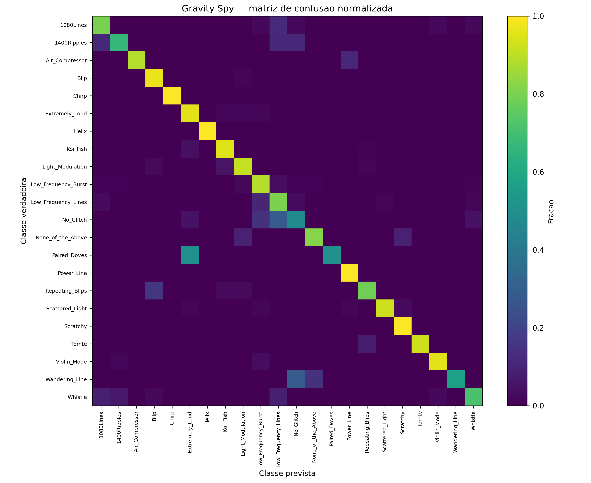

# Classificação de Glitches do LIGO com CNNs e Grad-CAM

Projeto 3 – Ondas Gravitacionais · **PIC Astronomia**

Repositório: <https://github.com/jean5429/gw-pic-2026>

Pipeline auditável que:

1. baixa e processa dados públicos do catálogo de ondas gravitacionais **GWTC** (GWOSC);
2. gera Q-grams (tempo × frequência) de cada evento e detector;
3. treina uma **ResNet-18** no conjunto **Gravity Spy** (22 classes de glitches);
4. aplica um ensemble de 5 modelos aos eventos reais, com detecção fora de distribuição (OOD);
5. usa **Grad-CAM** para ver onde a rede está olhando.

O relatório mais recente é o [Relatório V2 (PDF)](docs/relatorios/Relatorio_PIC_Ondas_Gravitacionais_V2.pdf). Ele registra a auditoria do pipeline e corrige conclusões do relatório V1.

---

## Estrutura

```text
src/gwproject/          pacote Python (pré-processamento, Q-grams, modelo, filtro casado, OOD)
scripts/                linhas de comando (download, treino, ensemble, Grad-CAM, ...)
configs/                parâmetros em TOML (processamento, Gravity Spy, ensemble)
tests/                  testes automatizados (pytest)
outputs/                resultados versionados (métricas, CSVs, figuras, modelos via LFS)
docs/relatorios/        relatórios PIC (V1, V2, verificação)
docs/historico/         notas de versão e migrações (v6 → v9)
docs/figuras/           figuras Grad-CAM das classes de treino
research/               programa científico, preregistro, protocolos
gw_student_kit/         kit didático independente (filtro casado e DSP)
ondasgravitacionais_*.py  pontos de entrada das versões v8/v9 e scripts camada1 v14/v15
```

---

## Instalação

Requer **Python 3.11** e, para treino ou inferência rápida, GPU NVIDIA com CUDA 12.1.

```powershell
git clone https://github.com/jean5429/gw-pic-2026.git
cd gw-pic-2026
conda env create -f environment-core.yml
conda activate gw-v8
python -m pip install --upgrade pip setuptools wheel
python -m pip install -e ".[gw,ml,test]"
```

PyTorch com CUDA (Windows):

```powershell
powershell -ExecutionPolicy Bypass -File .\scripts\install_gpu_windows.ps1
```

Sem GPU, instale a versão CPU (`pip install torch==2.5.1 torchvision==0.20.1`) e use `--device cpu` nos scripts.

---

## Dados (baixados sob demanda)

Nenhum dado bruto fica no repositório. Cada conjunto é baixado apenas quando você precisa dele.

| Conjunto | Tamanho | Necessário para | Como obter |
|---|---|---|---|
| Modelos treinados (5 seeds) | ~215 MB | ensemble, Grad-CAM | Git LFS (abaixo) ou treino próprio |
| Gravity Spy v1.1 (Zenodo 1486046) | ~11 GB | treino, referência OOD, Grad-CAM em treino | `scripts/download_gravity_spy.py` |
| Strain GWTC (GWOSC) + Q-grams | ~540 MB | ensemble em eventos reais | `scripts/run_catalog.py` |

### 1. Modelos treinados (Git LFS)

Os 5 checkpoints `outputs/gravity_spy_harmonized/seed_*/best_model.pt` (~45 MB cada) ficam no [Git LFS](https://git-lfs.com/). No repositório git fica só um "ponteiro" de poucos bytes para cada um; o arquivo real fica no servidor LFS do GitHub e é baixado à parte.

**Antes de clonar**, instale o Git LFS uma única vez na máquina. O Git for Windows já o inclui; no Linux, use `sudo apt install git-lfs`; no macOS, `brew install git-lfs`. Depois rode:

```powershell
git lfs install
```

Com isso, o `git clone` da seção [Instalação](#instalação) baixa os modelos automaticamente.

**Se você clonou sem o Git LFS**, os `.pt` serão ponteiros de texto (~130 bytes), e o PyTorch falha ao carregá-los com um erro como `invalid load key, 'v'`. Para baixar os arquivos reais, rode dentro do repositório:

```powershell
git lfs install
git lfs pull
```

**Baixar só parte dos modelos.** Por exemplo, só o seed 42, usado no Grad-CAM:

```powershell
$env:GIT_LFS_SKIP_SMUDGE = "1"
git clone https://github.com/jean5429/gw-pic-2026.git
cd gw-pic-2026
git lfs pull --include="outputs/gravity_spy_harmonized/seed_42_cuda_balanced/best_model.pt"
```

Para conferir se os modelos estão baixados, rode `git lfs ls-files`. Um `*` indica arquivo presente; um `-` indica que só o ponteiro está no disco.

> **Atenção:** o botão *Code → Download ZIP* do GitHub não inclui os arquivos LFS por padrão. Nesse caso, os 5 `best_model.pt` do ZIP são só ponteiros de texto (~130 bytes). Use `git clone` com o Git LFS instalado.
>
> O plano gratuito do GitHub tem cota mensal de banda para LFS, e cada download completo dos 5 modelos consome ~225 MB. Se a cota acabar, os downloads ficam bloqueados até o mês seguinte; nesse caso, use o treino próprio (seção [Treino completo](#treino-completo-opcional)).

### 2. Gravity Spy

```powershell
python -m scripts.download_gravity_spy --extract
python .\ondasgravitacionais_research_v9.py prepare-panels -- `
    .\data\gravity_spy\trainingset .\data\gravity_spy\trainingset_harmonized_20_512
```

O download confere o checksum oficial do Zenodo e retoma transferências interrompidas.

### 3. Eventos GWTC

```powershell
python -m scripts.run_catalog --download-strain --process --qgrams --workers 4
python -m scripts.check_catalog_ready
```

Use `--max-events 2` para um teste rápido. Os scripts `ondasgravitacionais__camada1_v14/v15.py` mantêm um cache próprio em `camada1_gwtc3/`, que é recriado automaticamente.

---

## Uso

### Ensemble nos eventos reais

```powershell
$M = "outputs\gravity_spy_harmonized"
python -m scripts.classify_catalog_qgrams_ensemble `
    $M\seed_101_cuda_balanced\best_model.pt $M\seed_11_cuda_balanced\best_model.pt `
    $M\seed_23_cuda_balanced\best_model.pt  $M\seed_42_cuda_balanced\best_model.pt `
    $M\seed_71_cuda_balanced\best_model.pt `
    --ood-reference outputs\research\ood_reference_seed42.npz `
    --output-dir outputs\research\gravity_spy_ensemble_gsrender
```

O pré-processamento vem de `configs/research_program.toml` (`[harmonized_inference]`). O padrão é `render_mode = "gravity_spy"`, que reproduz a escala de intensidade das imagens de treino.

### Grad-CAM

```powershell
# imagem de treino
python scripts\run_gradcam.py --image data\gravity_spy\trainingset_harmonized_20_512\TrainingSet\Chirp\H1_0fp5wZUWD7_spectrogram_1.0.png --output-dir docs\figuras

# evento real: converte o Q-gram com o mesmo pré-processamento do ensemble
python scripts\temp_npy_to_png.py --event GW150914-v4 --detectors L1
python scripts\run_gradcam.py --image outputs\gwtc\qgrams\GW150914-v4\L1_GW150914-v4.png --output-dir outputs\research\gradcam_fixed
```

No mapa, **vermelho = atenção máxima**. As figuras são salvas em 300 DPI.

### Treino completo (opcional)

```powershell
& .\scripts\run_research_program.ps1
```

O script harmoniza os painéis, treina 5 seeds, agrega as métricas, constrói a referência OOD e roda o ensemble.

### Matrizes de confusão

O treino salva, em cada `outputs/gravity_spy_harmonized/seed_*/`, a matriz em `confusion_matrix.npy` (contagens) e em `confusion_matrix.png` (normalizada por linha, 300 DPI). Para gerar os PNGs de novo a partir dos `.npy`, sem treinar:

```powershell
python -m scripts.replot_confusion_matrices
```

### Kit didático (`gw_student_kit`)

Kit independente do `gwproject`, para ensinar filtragem passa-banda, espectrogramas e filtro casado. Ele não precisa dos modelos nem do Gravity Spy:

```powershell
# demonstração com sinal sintético (reprodutível pela semente)
python gw_student_kit\main_demo.py --synthetic --seed 2026

# evento real já baixado pelo pipeline, com a massa de chirp no referencial do detector
python gw_student_kit\main_demo.py --event outputs\gwtc\raw\GW150914-v4 --chirp-mass 30.69
```

As figuras vão para `gw_student_kit/results/`. Em 10/10/2026, o filtro casado do kit foi corrigido (PR #1, Daniel Tedesco). Antes, ele dava SNRs absurdas, da ordem de 10¹¹ no GW150914, porque faltavam fatores de normalização da transformada de Fourier. Agora segue as convenções padrão do LIGO (Allen et al. 2012) e dá **ρ = 10,8 no L1 do GW150914**, no instante correto da fusão. O template é newtoniano (sem correções pós-newtonianas), então a SNR do kit é indicativa e não estabelece detecção. Detalhes no [guia do kit](gw_student_kit/README.md) e na seção 6.5 do [Relatório V2](docs/relatorios/Relatorio_PIC_Ondas_Gravitacionais_V2.pdf).

---

## Testes

```powershell
python -m pytest
```

Os testes que dependem de dados baixados (por exemplo, o Q-gram do GW150914) são pulados automaticamente quando os arquivos não existem.

---

## Resultados principais (V2)

| Item | Resultado |
|---|---|
| Gravity Spy, teste (5 seeds) | macro-F1 0,856 ± 0,006 · acurácia 0,909 |
| Grad-CAM nas classes de treino | atenção concentrada no próprio transiente |
| GWTC, renderização Gravity Spy | 15 classes previstas; 11 canais Chirp com confiança ≥ 0,95, todos de eventos intensos (GW150914, GW170814, …) |
| Domínio | os 150 canais ainda ficam acima do limiar OOD q99; resultados em dados reais são exploratórios |
| Kit didático, filtro casado corrigido | GW150914 L1: ρ = 10,8 (antes ~10¹¹); injeção sintética ρ = 14 recuperada como 12,9 no instante certo |

### Matriz de confusão (seed 42, conjunto de teste)



Cada linha soma 1, ou seja, é a fração da classe verdadeira. As classes mais difíceis são No_Glitch (F1 0,47–0,56 entre seeds), 1400Ripples (0,50–0,64) e Paired_Doves (0,57–0,67). As maiores confusões ocorrem em classes com poucas amostras de teste: Paired_Doves → Extremely_Loud (2 de 4), No_Glitch → Low_Frequency_Lines (6 de 21) e Wandering_Line → No_Glitch (2 de 7). As matrizes das outras seeds (11, 23, 71 e 101) estão no **Anexo C** do [Relatório V2](docs/relatorios/Relatorio_PIC_Ondas_Gravitacionais_V2.pdf) e em [`outputs/gravity_spy_harmonized/`](outputs/gravity_spy_harmonized/). O padrão se repete entre as seeds: No_Glitch (recall 0,38–0,52), Paired_Doves (0,50) e Wandering_Line (0,57–0,71) estão sempre entre as quatro classes de menor recall, e Chirp tem recall 1,00 em todas.

Detalhes, errata do V1 e próximos passos estão no [Relatório V2](docs/relatorios/Relatorio_PIC_Ondas_Gravitacionais_V2.pdf).

---

## Dados de terceiros e citações

- **GWOSC** – LIGO/Virgo/KAGRA Open Science Center, <https://gwosc.org>. Cite os artigos do catálogo GWTC correspondentes.
- **Gravity Spy** – Zevin et al. (2017), *Class. Quantum Grav.* 34, 064003; conjunto em Zenodo, registro 1486046.

Consulte as licenças e as orientações de citação de cada fonte antes de redistribuir os dados.

## Licença

Código sob licença [MIT](LICENSE).
