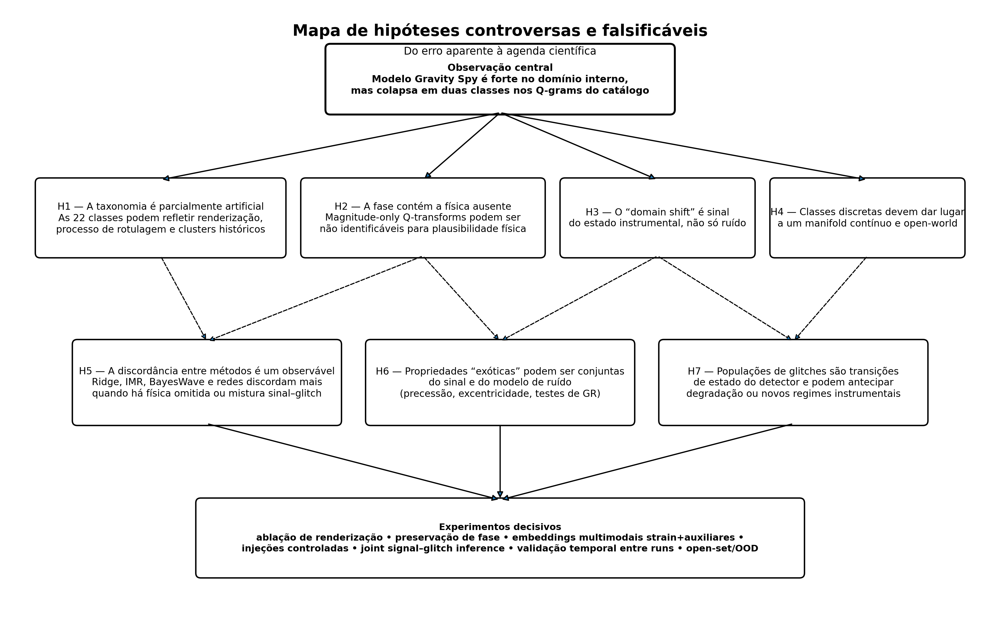
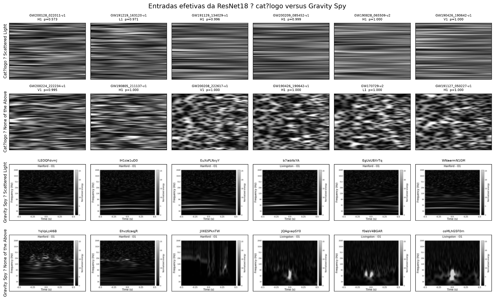
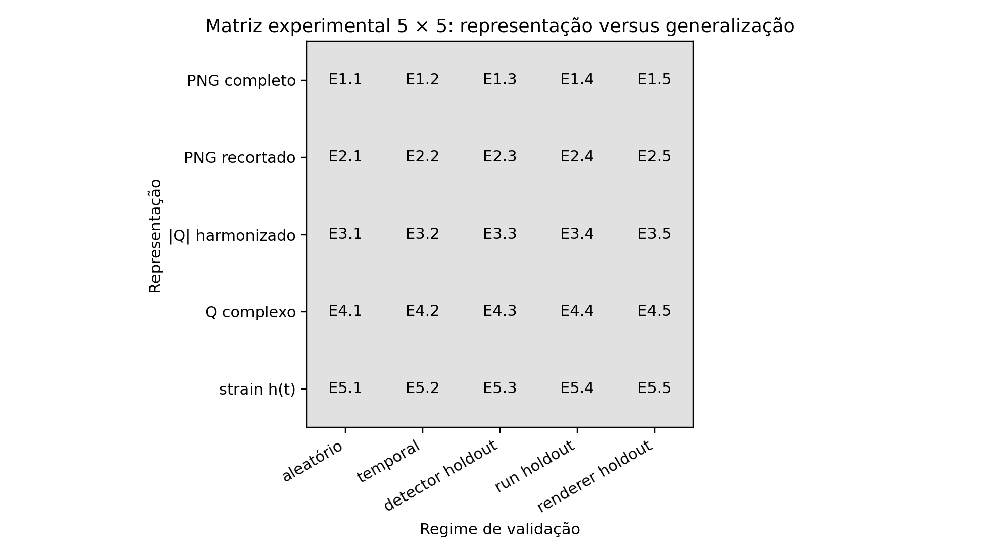
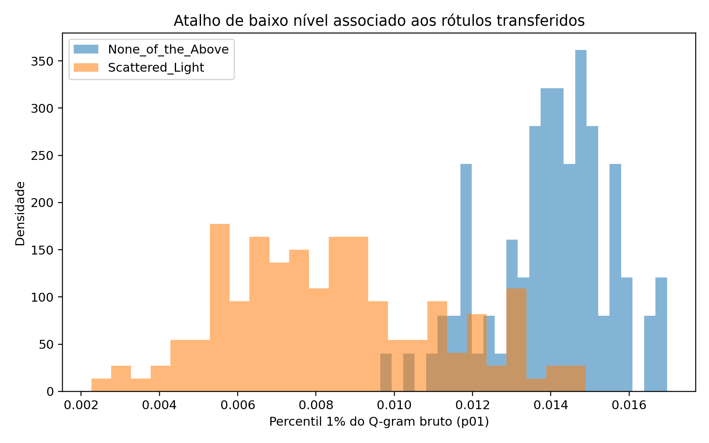
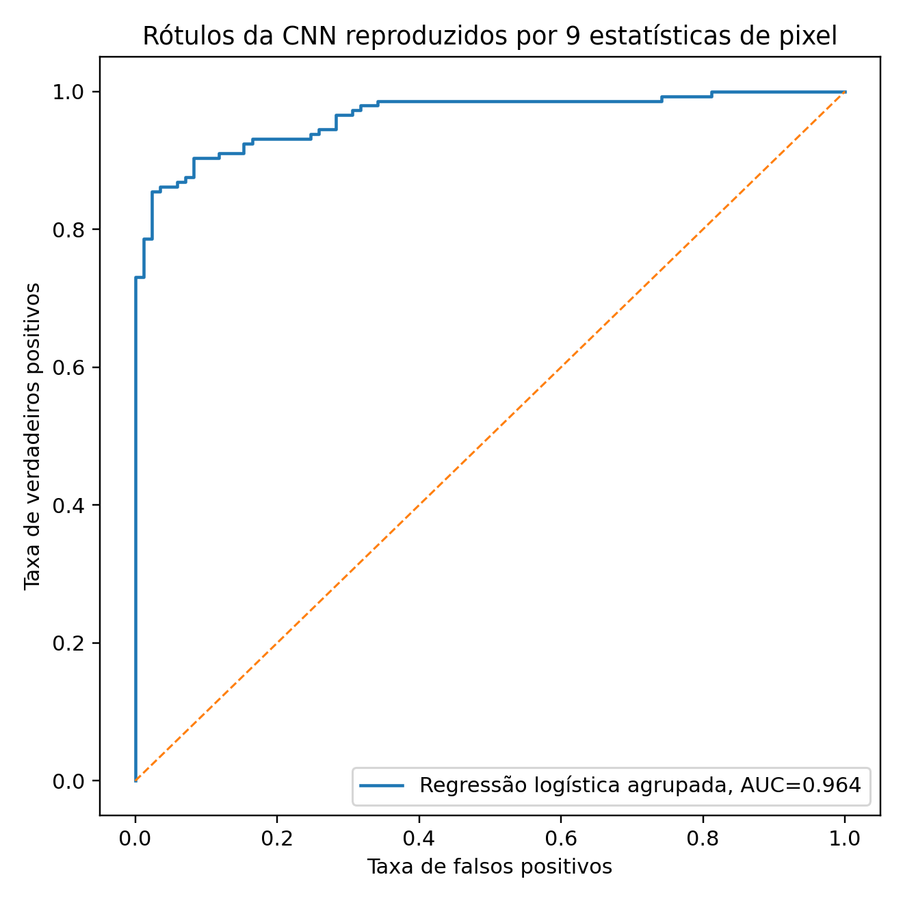
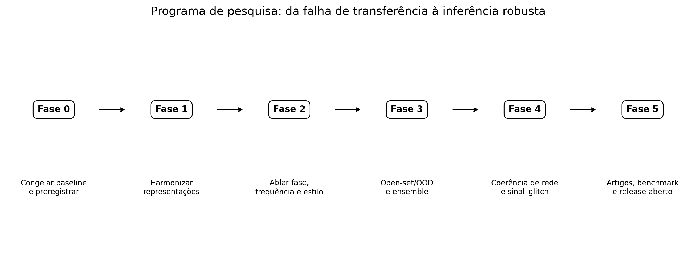

# Nota de escopo

Este dossiê contém o programa científico, revisão de escopo, hipóteses falsificáveis, preregistro, protocolos experimentais e guia de execução do pacote v9.0. O código foi testado unitariamente; os treinamentos harmonizados de grande escala precisam ser executados no ambiente local com os dados completos.


\newpage

# Parte I - Programa científico

# Sumário executivo

Este documento transforma os resultados do projeto `ondas_gravitacionais_v7/v8.3` em um programa científico falsificável. O ponto de partida não é a tentativa de salvar retrospectivamente as previsões do classificador Gravity Spy. O ponto de partida é o fato empírico de que uma rede com excelente desempenho interno falhou de maneira altamente estruturada quando transferida para Q-grams produzidos por outro pipeline.

A observação central é:

- cinco sementes da ResNet18 apresentaram macro-$F_1$ médio de aproximadamente $0{,}939$ no teste Gravity Spy;
- a aplicação aos 230 canais do catálogo usou somente duas das 22 classes: 145 `Scattered_Light` e 85 `None_of_the_Above`;
- 60 dos 90 eventos tiveram discordância entre detectores;
- a mediana da confiança softmax foi aproximadamente $0{,}9994$;
- nove estatísticas escalares do Q-gram bruto reproduzem os rótulos transferidos com balanced accuracy agrupada de $0{,}910$ e ROC-AUC de $0{,}964$;
- apenas o percentil inferior $p_{01}$ alcança balanced accuracy agrupada de $0{,}884$ e $|d|\approx2{,}35$.

Esses resultados mostram que a classificação transferida é dominada por propriedades de representação de baixo nível. Eles não mostram que 145 canais contêm scattered light. O resultado negativo, entretanto, sustenta uma pergunta científica relevante: **quais propriedades de uma representação tempo–frequência são invariantes, causalmente informativas e suficientes para distinguir sinal, glitch e estado instrumental?**

O programa propõe cinco eixos principais:

1. **invariância de representação e shortcut learning**;
2. **fase e identificabilidade física dos glitches**;
3. **open-set recognition e detecção de OOD**;
4. **coerência de rede e disentanglement detector–morfologia–estado**;
5. **fragilidade conjunta da inferência astrofísica ao waveform e ao modelo de glitch**.



# 1. Estado científico do projeto

## 1.1 Infraestrutura validada

A infraestrutura de aquisição e processamento contém:

- 90 eventos GWTC;
- 270 combinações evento–detector;
- 230 canais aprovados;
- arquivos brutos, séries processadas e Q-grams auditados;
- redshifts e massas detector-frame para todos os 90 eventos;
- manifestos de ambiente e configuração;
- testes funcionais e execução em CUDA.

Essa camada constitui um ativo científico independente. Ela permite reconstruir experimentos, registrar provenance e realizar ablações controladas.

## 1.2 Ridge

O ridge temporal foi útil para localizar regimes em que uma trajetória inspiral é ou não mensurável. Não foi validado como estimador catalogal de chirp mass. Na v8.3:

- 140 de 230 canais produziram uma estimativa;
- 60 foram classificados como `insufficient_inspiral_band`;
- 25 como `flat_ridge`;
- cinco como `insufficient_frequency_span`;
- o erro relativo mediano permaneceu em aproximadamente 52,2%;
- somente 36 estimativas ficaram abaixo de 30% de erro.

Uso permitido: diagnóstico tempo–frequência, estudo de identificabilidade e construção de um diagrama de regimes metodológicos.

Uso não permitido: estimativa de massa competitiva com inferência Bayesiana ou pipelines LVK.

## 1.3 Matched filtering pedagógico

O matched filter local foi construído ao redor das massas catalogadas. Na v8.3:

- 85 eventos foram processados;
- cinco ficaram sem template ativo;
- 30 passaram o limiar de SNR;
- 38 passaram a margem top-2;
- 13 passaram ambos os gates;
- somente cinco tiveram o template central em primeiro lugar.

O procedimento não possui background, false-alarm rate, time slides, teste $\chi^2$, reweighted SNR, busca cega ou trials factor. Portanto, mede compatibilidade local dentro de um banco pequeno; não mede significância de detecção.

## 1.4 Gravity Spy

A validação interna multiseed foi forte e estável. O problema está na validade externa. A folha de contato revelou diferenças profundas entre:

- PNGs Gravity Spy completos, com margens, eixos, textos e colorbar;
- Q-grams numéricos do catálogo ocupando todo o frame;
- faixas de frequência e escalas de intensidade distintas;
- transformação do piso normalizado pela mediana;
- possível inversão vertical entre a ordem das frequências no array e a convenção visual de alta frequência no topo.



# 2. Pergunta-mãe

> Quais características aprendidas por classificadores de glitches são invariantes à representação e correspondem a propriedades físicas do transiente ou do detector, e quais são atalhos específicos do renderer, do run ou do instrumento?

A pergunta envolve quatro níveis que devem ser separados:

1. **morfologia observada:** aparência em uma representação escolhida;
2. **forma de onda:** estrutura temporal, espectral e de fase;
3. **causa instrumental:** mecanismo físico que gerou o glitch;
4. **efeito inferencial:** viés produzido sobre parâmetros astrofísicos.

Uma classe visual pode ser útil sem ser uma espécie ontológica. Uma morfologia pode ter várias causas. Uma causa pode produzir várias morfologias, dependendo do estado do detector. Um rótulo com alta softmax não identifica necessariamente nenhuma dessas entidades.

# 3. Hipóteses centrais

## H1 — A taxonomia é dependente da representação

**Mecanismo.** As fronteiras entre classes Gravity Spy são parcialmente definidas por escolhas de janela temporal, faixa de frequência, colormap, normalização, elementos gráficos e processo histórico de rotulagem. A rede aprende uma combinação de morfologia e estilo do dataset.

**Predição principal.** O rótulo de uma fração não desprezível dos exemplos mudará sob transformações fisicamente equivalentes: remoção de eixos, mudança de renderer, equalização de intensidade ou mudança entre magnitude-Q e strain temporal.

**Falsificação.** A hipótese enfraquece se as classes permanecerem estáveis sob renderer holdout, detector holdout, run holdout e transformações que preservam a informação física.

## H2 — A fase é necessária para identificabilidade física

**Mecanismo.** A magnitude do Q-transform não determina unicamente a forma de onda. Pares com magnitude semelhante podem ter fases, coerência e mecanismos físicos distintos.

**Predição principal.** Randomização controlada da fase preservará parte da aparência espectral, mas destruirá a consistência para modelos temporal/phase-aware. Um classificador visual poderá manter alta confiança mesmo quando a forma de onda se tornar fisicamente implausível.

**Falsificação.** Modelos phase-aware não melhoram generalização, OOD ou validação causal, e a randomização de fase não altera tarefas fisicamente motivadas.

## H3 — O domain shift contém informação instrumental real

**Mecanismo.** Algumas características dependentes do detector não são meros nuisances. Elas podem codificar acoplamentos, configurações de controle ou microestados instrumentais.

**Predição principal.** O embedding permitirá prever detector, run e período temporal mesmo após controlar classe e SNR. Uma decomposição explícita poderá separar conteúdo morfológico, identidade do detector e estado latente.

**Falsificação.** A informação de detector desaparece após harmonização de renderer e não melhora nenhuma tarefa de detector characterization.

## H4 — A discordância entre métodos é um observável de fragilidade

Defina

$$
\mathbf D=(D_{\rm ridge},D_{\rm template},D_{\rm detector},D_{\rm class},D_{\rm residual},D_{\rm waveform}).
$$

**Mecanismo.** Física omitida e glitches sobrepostos deixam assinaturas diferentes de inconsistência entre detectores, modelos e representações.

**Predição principal.** Injeções com precessão, excentricidade, modos superiores ou glitches produzirão distribuições distintas de $\mathbf D$ depois de controlar massa e SNR.

**Falsificação.** $\mathbf D$ é totalmente explicado por massa total, SNR, duração e número de detectores.

## H5 — Propriedades astrofísicas sutis são conjuntas ao modelo de sinal e ruído

**Mecanismo.** A posteriori de spins, precessão, excentricidade ou desvios de GR depende do waveform, do modelo de glitch, da PSD, da calibração e da janela. Essa dependência pode ser forte em eventos contaminados.

**Predição principal.** Eventos com alta fragilidade no vetor $\mathbf D$ também mostrarão maior variação posterior entre combinações $(W_i,G_j)$ de waveform e modelo de glitch.

**Falsificação.** Parâmetros permanecem estáveis sob uma família razoável de waveforms, PSDs, janelas e modelos de glitch.

# 4. Hipóteses secundárias de alto risco

## H6 — `None_of_the_Above` é uma mistura de estados, não uma classe

Clusters estáveis dentro de `None_of_the_Above` podem corresponder a novas famílias, misturas, baixa SNR, mudanças de run ou entradas OOD.

## H7 — Populações de glitches antecipam transições do detector

Mudanças no espaço de embeddings podem preceder degradação de sensibilidade, aumento de falsos alarmes ou intervenções de commissioning.

## H8 — Alguns transientes classificados como glitches são coerentes e não modelados

Essa hipótese não autoriza alegações de nova física. Ela exige coerência de rede, time slides, ausência de correlação auxiliar e reconstrução por modelos agnósticos.

## H9 — A falha do ridge define um diagrama de regimes observacionais

O sucesso ou fracasso do ridge pode mapear a transição entre regime inspiral mensurável, regime IMR e regime burst/wavelet.

## H10 — Coerência de rede pode fornecer auto-supervisão

Pares de detectores do mesmo evento, depois de correções geométricas, podem fornecer positivos contrastivos; janelas aleatórias e glitches locais fornecem negativos.

# 5. Matriz experimental



As representações são:

1. PNG Gravity Spy completo;
2. PNG recortado para o painel físico;
3. magnitude $|Q|$ harmonizada;
4. Q-transform complexo ou magnitude+fase;
5. strain temporal $h(t)$.

Os regimes de validação são:

1. split oficial/aleatório;
2. holdout temporal;
3. detector holdout;
4. observing-run holdout;
5. renderer holdout.

Cada célula deve registrar:

- macro-$F_1$ e balanced accuracy;
- ECE e Brier score;
- OOD AUROC, AUPR e FPR@95TPR;
- predictability do detector;
- estabilidade entre sementes;
- estabilidade sob contrafactuais;
- custo computacional;
- intervalo de confiança por bootstrap agrupado.

# 6. Experimentos prioritários

## E1 — Auditoria de atalhos

**Objetivo.** Medir quanto dos rótulos pode ser previsto por características de baixo nível.

**Controles.** Split agrupado por evento; regressão logística; thresholds univariados treinados apenas no fold de treino; permutação de rótulos; bootstrap por evento.

**Resultado atual.** O probe de nove estatísticas atingiu balanced accuracy $0{,}910$ e AUC $0{,}964$. Isso é evidência contra uma interpretação puramente morfológica das previsões antigas.





## E2 — Harmonização do renderer

1. detectar automaticamente o painel escuro nos PNGs;
2. remover margens, títulos, eixos, ticks e colorbar;
3. recortar a banda 20–512 Hz supondo eixo logarítmico;
4. preservar ou documentar a convenção de frequência alta no topo;
5. aplicar a mesma geometria $140\times170$;
6. treinar cinco sementes novamente.

**Alerta.** A faixa original 10–2048 Hz inferida dos PNGs deve ser confirmada contra metadados oficiais. O código novo marca essa suposição no manifesto.

## E3 — Transformação do Q-gram

Comparar:

- `none`: $\log(1+Q)$;
- `subtract_one`: $\log[1+\max(Q-1,0)]$;
- `global_median`: $\log[1+\max(Q/{\rm med}(Q)-1,0)]$;
- `per_frequency_median`: $\log[1+\max(Q/{\rm med}_t Q-1,0)]$.

A última opção é o default do programa v9, pois o Q-transform foi normalizado pela mediana e o objetivo é representar excesso relativo de energia.

## E4 — Inversão vertical

A ordem de frequências no array deve ser auditada. Arrays numéricos normalmente armazenam a frequência em ordem crescente; uma imagem direta coloca a primeira linha no topo, o que pode inverter o eixo físico em relação ao renderer científico. O programa v9 inclui `flip_frequency=true` como hipótese explícita. Deve ser validada por injeção de linha em frequência conhecida.

## E5 — Ensemble e open-set

- média das probabilidades de cinco sementes;
- entropia preditiva;
- entropia esperada;
- informação mútua;
- fração de votos;
- energy score;
- distância de Mahalanobis no embedding;
- categorias `in_domain_candidate`, `review`, `reject_ood`.

Nenhuma dessas categorias é uma probabilidade causal de glitch.

## E6 — Contrafactuais de fase

Para cada waveform $h(t)$, gerar

$$
\tilde h_\alpha(t)=\mathcal F^{-1}\left[|H(f)|e^{i(\phi(f)+\alpha\Delta\phi(f))}\right],
$$

com $\alpha\in\{0,0.25,0.5,0.75,1\}$. Medir estabilidade de classe, embedding e confiança.

## E7 — Coerência de rede

Treinar uma representação contrastiva condicionada por detector e geometria. Positivos devem ser pares fisicamente associados; negativos incluem time slides e janelas off-source.

## E8 — Inferência conjunta sinal–glitch

Começar por GW200129 e GW191109, usando `bilby_glitch`, wavelets, chirplets e slow scattering, além de mais de um approximant. O produto não deve ser uma afirmação binária sobre precessão, mas um mapa de robustez da conclusão à escolha de modelos.

# 7. Dados e recursos

## 7.1 Recursos já disponíveis

- catálogo local de 90 eventos e 230 canais;
- dataset Gravity Spy v1d1;
- cinco checkpoints ResNet18;
- resultados de ridge e matched filter;
- CSVs de auditoria e Q-grams.

## 7.2 Recursos externos prioritários

- reconstruções temporais DeepExtractor no Hugging Face: 35 mil waveforms de 2 s, 4096 Hz, sete classes;
- modelos ViT/ResNet externos como baseline independente, com ressalva de que os resultados da model card são auto-relatados;
- dados públicos O4/O4b para holdout temporal e de run;
- modelos de glitches BayesWave publicados para eventos selecionados;
- GWOSC como fonte primária de strain e metadados.

## 7.3 Estratégia de uso do Hugging Face

Usar `datasets` em modo streaming para conjuntos grandes. O dataset O4b V1 em Parquet possui escala de dezenas de GB e mais de um bilhão de linhas; deve ser consultado por segmentos e projeção de colunas, não carregado integralmente em memória.

# 8. Critérios de sucesso e de parada

## Sucesso mínimo da harmonização

- macro-$F_1$ interno $\ge0{,}85$;
- ECE $\le0{,}08$;
- balanced accuracy do probe de pixels $\le0{,}70$;
- OOD AUROC $\ge0{,}80$ em conjuntos sintéticos e reais definidos a priori;
- nenhuma classe dominante acima de 80% no catálogo sem justificativa independente;
- estabilidade de classe sob pequenas mudanças de contraste;
- auditoria visual cega com concordância interavaliadores.

## Critérios de parada

Interromper a interpretação física se:

- o renderer puder prever a classe melhor que a morfologia;
- a validação cair drasticamente em detector/run holdout;
- OOD não for separável de in-domain;
- a classe mudar sob transformações fisicamente equivalentes;
- a conclusão depender de thresholds escolhidos após observar o catálogo.

# 9. Produtos científicos

## Artigo 1 — Representação e shortcut learning

**Título provisório:** *When a glitch image stops being a physical representation: renderer shortcuts and domain shift in gravitational-wave transient classification*.

Contribuição: benchmark controlado de renderers, probe de baixo nível, detector/run/renderer holdout e guidelines de validade externa.

## Artigo 2 — Fase e identificabilidade

**Título provisório:** *Phase blindness in gravitational-wave glitch classification*.

Contribuição: contrafactuais que preservam magnitude espectral, comparação entre modelos visuais, complexos e temporais.

## Artigo 3 — Fragilidade sinal–glitch

**Título provisório:** *A signal–glitch fragility atlas for compact-binary inference*.

Contribuição: marginalização sobre famílias de waveform e glitch; índice de fragilidade; estudos de caso.

## Recurso aberto

- benchmark de domínio;
- manifests e splits;
- scripts de harmonização;
- Q-grams e embeddings permitidos por licença;
- model cards;
- datasheets;
- resultados negativos.

# 10. Roteiro



## Fase 0 — concluída no pacote v9

- congelamento do baseline v8.3;
- auditoria agrupada dos atalhos;
- código para harmonização de painéis;
- transformações de baseline e inversão de frequência;
- ensemble e métricas OOD;
- contrafactuais de fase;
- testes unitários;
- preregistro e política de alegações.

## Fase 1 — execução local necessária

- preparar o dataset harmonizado;
- inspecionar amostra visual;
- retreinar cinco sementes;
- construir referência OOD;
- classificar com ensemble;
- repetir auditoria de pixels.

## Fase 2 — extensão científica

- adicionar strain temporal e reconstruções DeepExtractor;
- implementar magnitude+fase;
- renderer/run/detector holdouts;
- auto-supervisão de coerência.

## Fase 3 — inferência astrofísica

- estudos GW200129 e GW191109;
- atlas de fragilidade;
- validação cruzada com BayesWave e `bilby_glitch`.

# 11. Conclusão

O projeto deve abandonar a meta estreita de produzir mais rótulos Gravity Spy e adotar uma meta científica mais forte: **determinar quais conclusões permanecem invariantes quando a representação, o detector, o run e o modelo de ruído mudam**.

A hipótese mais controversa, mas rigorosa, é que uma parte do que chamamos de “classe de glitch” e uma parte do que chamamos de “propriedade sutil da fonte” são propriedades conjuntas do sistema de medição, da representação e do modelo inferencial. O programa v9 não assume que isso seja verdadeiro; ele constrói testes capazes de demonstrar quando é verdadeiro e quando é falso.


\newpage

# Parte II - Revisão da literatura

# 1. Natureza da revisão

Esta é uma revisão de escopo estruturada, não uma revisão sistemática exaustiva. A busca foi atualizada em 25 de julho de 2026 e priorizou artigos revisados por pares, preprints recentes, documentos LVK/GWOSC e recursos científicos abertos. Os eixos de busca foram:

- Gravity Spy, taxonomia, multi-view e evolução entre observing runs;
- classificação supervisionada e descoberta não supervisionada de glitches;
- reconstrução temporal e modelos generativos;
- BayesWave, modelos conjuntos sinal–glitch e robustez da inferência;
- shortcut learning, domain shift, calibration e OOD;
- recursos Hugging Face/Hugging Science aplicáveis a ondas gravitacionais.

As afirmações sobre o projeto local derivam de seus próprios resultados. As afirmações sobre o estado da arte derivam das referências listadas em `REFERENCIAS.bib`. Preprints de 2025–2026 são tratados como evidência provisória.

# 2. Gravity Spy e a natureza das classes

Gravity Spy integra citizen science e machine learning para classificar transientes não gaussianos por morfologia tempo–frequência. O trabalho fundador estabeleceu uma taxonomia operacional que permite triagem rápida e investigação de causas instrumentais. O dataset formalizado por Bahaadini et al. consolidou imagens e metadados para tarefas de ML.

A literatura posterior mostra que a taxonomia não é estática. As distribuições de glitches diferem entre Hanford e Livingston, e novas morfologias emergem com mudanças do instrumento e do ambiente. A análise de O3 classificou centenas de milhares de glitches e concluiu que estudos de qualidade de dados podem precisar ser específicos para cada observatório. O artigo de lições aprendidas enfatiza o acoplamento contínuo entre voluntários e modelos, precisamente porque classes desconhecidas e mudanças de domínio permanecem relevantes.

A evolução para O4 adotou multi-view fusion e atenção, reconhecendo que uma única janela temporal perde informação. Isso sustenta duas conclusões:

1. as classes são úteis para detector characterization;
2. a estabilidade da classe depende da representação, do run e da janela.

# 3. Descoberta não supervisionada e open-world

Métodos de clustering, similarity learning, autoencoders e embeddings foundation-model procuram reduzir a dependência de rótulos fechados. O CTSAE combina múltiplas escalas temporais e componentes CNN/ViT. Trabalhos de similarity learning buscaram encontrar exemplos semelhantes e candidatos a novas classes. Um estudo O4a de 2026 com DINOv2 congelado relatou um resultado nulo para novas morfologias no conjunto analisado, mas observou diferenças estruturais entre os manifolds de H1 e L1.

Esse resultado nulo é cientificamente importante: discovery pipelines precisam controlar estabilidade de clustering, ablações, time slides e comparação com referência in-domain. Anomalia visual sem esses controles não é nova classe.

# 4. Limitação das imagens de magnitude

Imagens Q-transform são excelentes ferramentas diagnósticas, mas não são representações invertíveis da forma de onda. A magnitude perde fase e pode apagar distinções relevantes para causalidade e coerência. O projeto GlitchGAN, construído no domínio temporal e com derivadas, foi motivado pela necessidade de gerar waveforms fisicamente mais realistas. Sua análise indica que classificadores de imagens de magnitude podem atribuir alta confiança a formas temporalmente inadequadas.

DeepExtractor vai além da classificação e reconstrói sinal ou glitch no domínio temporal. O trabalho reporta comparação com BayesWave e generalização para dados Gravity Spy. Independentemente dos números específicos, sua contribuição conceitual é clara: avaliação por mismatch e reconstrução temporal é mais próxima da física do que apenas acurácia de classe visual.

# 5. Signal–glitch joint inference

BayesWave formulou sinais coerentes e glitches incoerentes em uma base transdimensional de wavelets. Isso permite comparar hipóteses sem exigir uma waveform CBC específica. Trabalhos recentes ampliam o problema para inferência conjunta de parâmetros astrofísicos e glitches.

`bilby_glitch`, publicado como preprint em julho de 2026, implementa modelos de slow scattering, sine-Gaussian e chirplet em uma estrutura modular. A reanálise de GW200129 é especialmente relevante: a evidência de precessão muda com a combinação entre approximant e modelo de glitch. A conclusão correta não é que precessão “não existe”, mas que a robustez da inferência deve ser testada no espaço produto

$$
\mathcal W\times\mathcal G,
$$

onde $\mathcal W$ é a família de waveforms e $\mathcal G$ a família de modelos de glitch.

GW191109 também tem sido discutido como exemplo de spins interessantes sob problemas de qualidade de dados. Esses casos tornam plausível uma agenda de “fragilidade inferencial”, desde que ela seja conduzida sem selecionar apenas eventos favoráveis à hipótese.

# 6. Shortcut learning e domain shift

Shortcut learning descreve regras que funcionam em benchmarks, mas falham quando o ambiente muda. Em imagens científicas, margens, textos, marcas de equipamento, protocolos de aquisição e estilos de renderer podem ser mais fáceis de aprender que o fenômeno de interesse.

O projeto local constitui um caso diagnóstico:

- o modelo foi treinado em PNGs completos;
- as entradas externas foram matrizes renderizadas de forma distinta;
- a softmax permaneceu extrema;
- somente duas classes foram usadas;
- estatísticas de pixel reproduziram os rótulos.

Isso é compatível com shortcut learning, mas não identifica sozinho qual atalho a rede utilizou. São necessários saliency, counterfactuals, renderer holdout e probes controlados.

# 7. Incerteza, calibração e OOD

Redes modernas podem ser mal calibradas mesmo em dados in-domain. Temperature scaling é uma correção simples para calibration, mas não resolve OOD. Maximum softmax probability é um baseline, não uma garantia de validade externa.

A literatura oferece várias famílias:

- ODIN: perturbação de entrada e temperature scaling;
- Mahalanobis: distância a distribuições class-conditionais no embedding;
- energy scores: função dos logits mais apropriada que softmax para separação OOD em muitos benchmarks;
- Outlier Exposure: treino com exemplos externos;
- deep ensembles: dispersão entre modelos como incerteza epistemológica;
- conformal prediction sob covariate shift: cobertura com hipóteses explícitas de pesos/importância.

Nenhum método garante OOD universal. Por isso o programa v9 combina métricas e usa rejeição open-world, sem converter scores em probabilidade física.

# 8. Domain generalization

DANN tenta remover informação de domínio adversarialmente. IRM busca preditores invariantes entre ambientes. Group DRO minimiza risco no pior grupo. A literatura de robustez, contudo, mostra que “invariância” pode falhar se os ambientes não forem definidos de maneira causalmente informativa.

No caso GW, os ambientes naturais são:

- detector;
- observing run;
- período temporal;
- renderer;
- janela temporal;
- faixa de frequência;
- método de whitening/PSD.

Uma estratégia adequada não deve remover toda informação de detector. Parte dela pode ser o fenômeno instrumental que queremos estudar. O objetivo é disentanglement, não cegueira automática ao instrumento.

# 9. Recursos abertos para o programa

## 9.1 DeepExtractor reconstructions

O dataset público contém 35 mil waveforms balanceadas de sete classes, janelas de 2 s e amostragem de 4096 Hz. Ele permite experimentos phase-aware e comparação entre imagem e forma de onda.

## 9.2 Modelos externos de classificação

Uma model card pública oferece ViT e ResNet para Gravity Spy O3 e relata avaliação temporal/O4. Esses números são auto-relatados e o manuscrito estava submetido; o recurso deve ser usado como baseline externo, não como padrão-ouro.

## 9.3 Dados O4b

Há conversões Parquet de strain público O4b. Um exemplo V1 possui mais de um bilhão de linhas e 22,1 GB. O uso correto é streaming, seleção de segmentos e projeção de colunas.

# 10. Lacunas identificadas

1. Poucos trabalhos medem estabilidade da classe sob renderers fisicamente equivalentes.
2. A fase é raramente incorporada em taxonomias visuais.
3. OOD costuma ser avaliado em benchmarks genéricos, não entre observing runs e pipelines GW.
4. A ligação entre embeddings de glitches e microestados instrumentais é pouco explorada publicamente.
5. A robustez de parâmetros astrofísicos à marginalização conjunta waveform–glitch ainda está emergindo.
6. Há pouca padronização de datasheets, manifests e renderer provenance para Q-transforms.
7. A categoria `None_of_the_Above` é frequentemente usada sem decomposição open-world rigorosa.

# 11. Síntese crítica

A literatura sustenta uma mudança de foco: de classificação fechada de imagens para modelagem multimodal, open-world e causalmente informada. O projeto local não deve competir com Gravity Spy em acurácia interna. Sua contribuição potencial está em demonstrar, de forma reprodutível, quais conclusões sobrevivem à mudança de representação e quais colapsam.

A evidência atual é forte para a existência de domain shift e associação com propriedades de baixo nível; é moderada para shortcut específico; é ainda insuficiente para alegar microestados instrumentais, nova taxonomia ou impacto astrofísico. Essas últimas são hipóteses a testar.

# Referências essenciais

Consulte `REFERENCIAS.bib`. As referências nucleares incluem Zevin et al. (2017, 2024), Bahaadini et al. (2018), Glanzer et al. (2023), Wu et al. (2025), DeepExtractor (2025), GlitchGAN (2026), BayesWave, `bilby_glitch` (2026), Geirhos et al. (2020), Lee et al. (2018), Liu et al. (2020), Lakshminarayanan et al. (2017) e Guo et al. (2017).


\newpage

# Parte III - Hipóteses controversas

# Princípio

Hipótese controversa não é licença para especulação sem controle. Cada hipótese abaixo inclui mecanismo, observações compatíveis, alternativas, previsão, teste e falsificação.

# H1. As classes Gravity Spy não são espécies naturais

## Mecanismo

As classes seriam partições úteis de um manifold contínuo de estados instrumentais e representações. As fronteiras surgiriam de decisões humanas, janelas e renderer.

## Evidências compatíveis

- evolução da taxonomia entre runs;
- classes novas e `None_of_the_Above`;
- interpolação morfológica em modelos generativos;
- diferenças entre detectores;
- colapso local sob mudança de renderer.

## Alternativas

- a taxonomia pode ser fisicamente estável, e o problema local ser apenas preprocessing incorreto;
- classes podem ser estáveis em um domínio bem definido, sem pretensão universal.

## Predição

A estabilidade de classe cairá em renderer/run/detector holdout mais que em split aleatório.

## Falsificação

As classes permanecem separáveis e consistentes em $h(t)$, magnitude+fase, painéis recortados e runs distintos.

# H2. A fase é uma variável causal oculta

## Mecanismo

Magnitude-Q comprime muitas waveforms diferentes. Fase e coerência temporal distinguem mecanismos que parecem semelhantes em potência.

## Teste

Gerar contrafactuais com magnitude espectral preservada e fase randomizada. Comparar CNN visual, modelo temporal e modelo complexo.

## Predição quantitativa

A estabilidade de classe visual permanecerá alta para $\alpha\to1$, enquanto mismatch temporal e scores phase-aware mudarão fortemente.

## Falsificação

Todos os modelos e métricas físicas permanecem estáveis, sem vantagem phase-aware.

# H3. O nuisance de detector é um sinal científico

## Mecanismo

O embedding codifica microestado, acoplamentos e configurações do detector. Remover identidade pode apagar informação de detector characterization.

## Teste

Decompor embedding em $z_m$ (morfologia), $z_d$ (detector) e $z_s$ (estado temporal). Avaliar previsão de run, detector e changepoints.

## Predição

$z_s$ antecipa mudanças de taxa de glitches ou sensibilidade.

## Falsificação

A informação desaparece após harmonização e não antecipa nenhum indicador independente.

# H4. A discordância é um observável de física omitida

## Mecanismo

Diferentes métodos falham de modos complementares. A geometria das discordâncias distingue glitch, baixa SNR e waveform inadequada.

## Teste

Injeções fatoriais: circular/precessing/eccentric/higher modes × sem glitch/com glitch × SNR × detector.

## Predição

Um classificador de $\mathbf D$ separa física omitida de glitch acima de um baseline que usa apenas massa e SNR.

## Falsificação

O ganho desaparece depois de controlar variáveis triviais.

# H5. Precessão e outros parâmetros sutis são propriedades conjuntas da análise

## Mecanismo

A conclusão depende de $(W,G,P,C,T)$: waveform, glitch, PSD, calibração e janela.

## Teste

Grade de modelos e model averaging. Medir divergência de Jensen–Shannon entre posteriores e mudança de Bayes factor.

## Predição

Eventos com maior fragilidade local terão maior variabilidade posterior.

## Falsificação

Parâmetros e evidências são estáveis em toda a grade plausível.

# H6. `None_of_the_Above` contém múltiplas famílias estáveis

## Teste

Clustering multiview e phase-aware, bootstrap, estabilidade por seed, validação humana cega e correlação com canais auxiliares.

## Critério forte

Um candidato a nova família requer recorrência, cluster estável, assinatura independente e ausência de explicação por renderer.

# H7. Populações de glitches são um sistema dinâmico com transições de fase

## Mecanismo

O detector alterna entre microestados. Taxas e embeddings funcionam como parâmetros de ordem observacionais.

## Teste

HMM, changepoint Bayesiano e state-space models em séries temporais longas.

## Predição

Changepoints precedem degradação ou intervenção.

# H8. Uma minoria de glitches aparentes pode ser coerente

## Controle anti-sensacionalismo

- amostra off-source;
- time slides;
- background empírico;
- blind injections;
- canais auxiliares;
- BayesWave/GWAK;
- resposta de antena.

A ausência de classe não é evidência de sinal.

# H9. O ridge mapeia identificabilidade, não massa

## Produto

Diagrama de regimes em $(M_{\rm det},q,\rho,T_{\rm inspiral})$ indicando método apropriado: ridge, IMR, wavelet ou não identificável.

# H10. A coerência pode substituir rótulos humanos em parte do treino

## Teste

Aprendizado contrastivo com pares de detectores alinhados, negativos por time slides e hard negatives de glitches coincidentes.

# Priorização

| Hipótese | Novidade | Viabilidade | Risco | Prioridade |
|---|---:|---:|---:|---:|
| H1 representação | alta | alta | moderado | 1 |
| H2 fase | muito alta | moderada | moderado | 2 |
| H5 fragilidade | muito alta | baixa/moderada | alto | 3 |
| H3 microestados | muito alta | moderada | alto | 4 |
| H4 discordância | alta | alta com injeções | moderado | 5 |
| H6 open-world | alta | moderada | alto | 6 |
| H7 prognóstico | muito alta | baixa | alto | 7 |
| H8 coerência anômala | alta | baixa | muito alto | 8 |


\newpage

# Parte IV - Preregistro

# 1. Título

Invariância de representação, atalhos de renderer e detecção open-world em classificadores de transientes de detectores de ondas gravitacionais.

# 2. Status

Preregistro prospectivo para os experimentos da v9. Os resultados v8.3 são considerados dados exploratórios já observados. Eles não podem ser usados como confirmação das hipóteses preregistradas.

# 3. Pergunta primária

Depois de harmonizar geometria, faixa de frequência e transformação de intensidade, o desempenho e a calibração do classificador permanecem estáveis em renderer holdout e detector holdout?

# 4. Hipóteses confirmatórias

## H1 primária

A balanced accuracy de um probe logístico baseado em nove estatísticas escalares será menor ou igual a 0,70 depois da harmonização.

## H2 primária

O classificador harmonizado obterá macro-$F_1\ge0{,}85$ no split oficial e macro-$F_1\ge0{,}65$ em renderer holdout.

## H3 primária

Um score OOD combinado alcançará AUROC $\ge0{,}80$ para separar validação Gravity Spy de contrafactuais/renderers deliberadamente deslocados.

## H4 secundária

A informação mútua do ensemble será maior em dados deslocados que na validação in-domain.

## H5 secundária

A randomização de fase afetará modelos temporal/phase-aware mais fortemente que o classificador visual.

# 5. Dados

- Gravity Spy v1d1 com splits oficiais;
- painéis harmonizados derivados dos PNGs;
- 230 Q-grams catalogais;
- DeepExtractor reconstructions para experimentos temporais;
- dados O4/O4b apenas como holdout externo;
- injeções simuladas e contrafactuais registrados separadamente.

# 6. Exclusões

Serão excluídos apenas:

- arquivos ausentes/corrompidos;
- imagens cujo painel não puder ser detectado pelo algoritmo preregistrado;
- arrays não finitos;
- exemplos duplicados entre splits;
- dados cuja licença impeça a análise.

Não serão removidos exemplos por “aparência ruim” ou por prejudicarem as métricas.

# 7. Pré-processamento fixado

## Gravity Spy

1. detecção automática da maior região escura contígua;
2. remoção de eixos, títulos e colorbar;
3. recorte log-frequency de 20–512 Hz, condicionado à confirmação da banda original;
4. resize $140\times170$;
5. grayscale;
6. normalização usada no treino.

## Catálogo

1. recorte temporal central 4 s $\to$ 1 s;
2. baseline `per_frequency_median`;
3. excesso relativo $\max(Q/b-1,0)$;
4. $\log(1+x)$;
5. inversão vertical validada por teste de linha conhecida;
6. percentis 1–99,5%;
7. resize $140\times170$.

# 8. Modelos

- ResNet18 grayscale, cinco sementes: 11, 23, 42, 71, 101;
- baseline regressão logística 32×32;
- probe de nove estatísticas;
- baseline externo ViT/ResNet apenas como análise exploratória;
- modelos temporal/phase-aware em fase posterior.

# 9. Métricas primárias

- macro-$F_1$;
- balanced accuracy;
- ECE;
- OOD AUROC;
- probe balanced accuracy;
- renderer holdout macro-$F_1$.

# 10. Métricas secundárias

- Brier score;
- FPR@95TPR;
- AUPR-in e AUPR-out;
- mutual information do ensemble;
- vote fraction;
- Mahalanobis distance;
- energy score;
- per-class $F_1$;
- detector predictability;
- classe dominante e entropia da distribuição de classes.

# 11. Splits e dependência

Amostras associadas ao mesmo evento ou trigger não podem aparecer em treino e teste. Bootstrap e intervalos serão agrupados por evento/trigger. Renderer variants da mesma amostra permanecem no mesmo fold.

# 12. Testes estatísticos

- intervalos bootstrap de 95%, agrupados;
- diferenças de métricas com bootstrap pareado;
- correção Benjamini–Hochberg para famílias de testes secundários;
- tamanhos de efeito além de $p$-values;
- nenhuma seleção de threshold no conjunto final de teste.

# 13. Análises exploratórias

- clustering de `None_of_the_Above`;
- microestados instrumentais;
- correlação com ridge e matched filter;
- estudos de GW200129/GW191109;
- descoberta de candidatos coerentes.

Essas análises serão rotuladas como exploratórias e exigirão validação independente.

# 14. Regras de decisão

## Evidência favorável à invariância

- probe baixo;
- renderer holdout forte;
- calibration aceitável;
- baixa sensibilidade a transformações equivalentes;
- diversidade plausível de classes;
- OOD detectável.

## Evidência contra

- probe $>0{,}75$;
- colapso em uma ou duas classes;
- softmax extrema em OOD;
- queda $>30\%$ em holdout;
- predição dominada por detector/renderer sem relação instrumental independente.

# 15. Política de transparência

Todos os resultados serão reportados, inclusive falhas. O pipeline antigo será preservado como baseline. Mudanças de preprocessing gerarão novos manifests e não sobrescreverão resultados v8.3.


\newpage

# Parte V - Matriz experimental

# Matriz experimental e ablações

## A. Representações

| ID | Representação | Informação preservada | Risco principal |
|---|---|---|---|
| R1 | PNG completo | estilo + painel | shortcut gráfico |
| R2 | painel recortado | magnitude renderizada | renderer/colormap |
| R3 | Q harmonizado | magnitude numérica | perda de fase |
| R4 | magnitude+fase | Q complexo | complexidade/calibração |
| R5 | strain temporal | waveform | sensibilidade a PSD/whitening |

## B. Holdouts

| ID | Holdout | Pergunta |
|---|---|---|
| V1 | split oficial | capacidade interna |
| V2 | temporal | drift |
| V3 | detector | generalização instrumental |
| V4 | run | generalização histórica |
| V5 | renderer | dependência visual |

## C. Ablations preregistradas

1. eixos presentes/ausentes;
2. colorbar presente/ausente;
3. banda 20–512 versus banda completa;
4. frequência linear/log;
5. frequência alta no topo/baixo;
6. baseline none/subtract-one/global/per-frequency;
7. percentis 0–100, 1–99,5 e normalização global;
8. 1 s versus quatro escalas temporais;
9. grayscale versus colormap original;
10. uma seed versus ensemble.

## D. Negative controls

- rótulos permutados;
- imagens com painel mascarado e margens preservadas;
- margens preservadas e painel randomizado;
- phase randomization;
- frequency shuffling;
- time reversal;
- time slides entre detectores;
- ruído gaussiano colorido pela PSD.

## E. Positive controls

- exemplos Gravity Spy de alta confiança in-domain;
- injeções de linhas estacionárias;
- slow scattering simulado;
- chirps CBC simulados;
- glitches temporais do DeepExtractor.

## F. Critério de interpretação

Um modelo só será chamado de “morfologicamente robusto” se superar os controles negativos de estilo e generalizar em renderer holdout. Um modelo só será chamado de “fisicamente informativo” se seus scores se relacionarem a uma variável independente: waveform temporal, canal auxiliar, coerência de rede ou mecanismo simulado.


\newpage

# Parte VI - Guia de execução

# Guia de execução da v9.0 Research

## 1. Instalação

No PowerShell, na raiz do projeto:

```powershell
conda activate gw-v7
$env:CUBLAS_WORKSPACE_CONFIG = ":4096:8"
$env:PYTHONNOUSERSITE = "1"
python -m pip install -e ".[ml,gw,test]"
python -m pytest -q
```

Esperado: todos os testes funcionais passam. Os testes não executam treinamento completo.

## 2. Preservar baseline

Não sobrescreva `outputs/gwtc/gravity_spy_predictions`. Crie um snapshot:

```powershell
$stamp = Get-Date -Format "yyyyMMdd_HHmmss"
Copy-Item .\outputs\gwtc\gravity_spy_predictions `
  ".\outputs\gwtc\snapshots\gravity_spy_v8_3_$stamp" -Recurse
```

## 3. Executar programa completo

```powershell
Set-ExecutionPolicy -Scope Process Bypass -Force
& .\scripts\run_research_program.ps1
```

O script:

1. prepara painéis Gravity Spy harmonizados;
2. treina cinco sementes em diretório novo;
3. agrega métricas;
4. constrói referência OOD da seed 42;
5. classifica os 230 canais por ensemble;
6. salva resultados em `outputs/research`.

## 4. Inspeção obrigatória antes do treino

Depois de preparar painéis, abra 50 imagens aleatórias e confirme:

- painel sem títulos/eixos/colorbar;
- frequência alta no topo;
- faixa física correta;
- ausência de crop excessivo;
- tamanho 170×140;
- nenhuma classe com processamento sistematicamente diferente.

O script assume que o painel original cobre aproximadamente 10–2048 Hz em escala logarítmica. Essa hipótese deve ser confirmada.

## 5. Auditoria antiga

```powershell
python .\ondasgravitacionais_research_v9.py audit-domain -- `
  .\outputs\gwtc\gravity_spy_predictions\qgram_domain_statistics.csv `
  --output-dir .\outputs\research\baseline_domain_audit
```

## 6. Preparar painéis separadamente

```powershell
python .\ondasgravitacionais_research_v9.py prepare-panels -- `
  .\data\gravity_spy\trainingset `
  .\data\gravity_spy\trainingset_harmonized_20_512 `
  --overwrite
```

## 7. Treinar sementes

```powershell
python -m scripts.run_gravity_spy_seeds `
  .\data\gravity_spy\trainingset_v1d1_metadata.csv `
  .\data\gravity_spy\trainingset_harmonized_20_512 `
  --profile cuda_balanced `
  --output-dir .\outputs\gravity_spy_harmonized
```

## 8. Referência OOD

```powershell
$checkpoint42 = Get-ChildItem `
  .\outputs\gravity_spy_harmonized `
  -Recurse -Filter best_model.pt |
  Where-Object {$_.FullName -match "seed_42"} |
  Select-Object -First 1

python .\ondasgravitacionais_research_v9.py build-ood -- `
  $checkpoint42.FullName `
  .\data\gravity_spy\trainingset_v1d1_metadata.csv `
  .\data\gravity_spy\trainingset_harmonized_20_512 `
  --device cuda `
  --output .\outputs\research\ood_reference_seed42.npz
```

## 9. Ensemble

```powershell
python .\ondasgravitacionais_research_v9.py classify-ensemble -- `
  .\outputs\gravity_spy_harmonized `
  --approved .\outputs\gwtc\approved_channels.csv `
  --device cuda `
  --ood-reference .\outputs\research\ood_reference_seed42.npz `
  --output-dir .\outputs\research\gravity_spy_ensemble
```

## 10. Interpretação dos outputs

- `in_domain_candidate`: compatível com a referência estatística; não prova origem física;
- `review`: discordância do ensemble ou OOD moderado;
- `reject_ood`: incompatibilidade forte; não significa sinal astrofísico;
- `vote_fraction`: consenso entre sementes;
- `mutual_information`: componente epistemológica aproximada;
- `energy_mean`: score de energia;
- `mahalanobis_distance`: distância ao embedding de validação.

## 11. Contrafactuais de fase

O script recebe NPY 1D de strain/reconstrução:

```powershell
python .\ondasgravitacionais_research_v9.py phase-counterfactuals -- `
  .\dados\exemplo_strain.npy `
  --output-dir .\outputs\research\phase_counterfactuals
```

Ele preserva o módulo do espectro de Fourier e altera a fase gradualmente.

## 12. Falhas que exigem interrupção

- painel detectado incorretamente em mais de 1% das imagens;
- classes com taxa de falha de crop diferente;
- probe de pixels acima de 0,75 após harmonização;
- colapso em uma ou duas classes novamente;
- OOD thresholds classificando quase tudo como in-domain;
- resultados sensíveis ao threshold escolhido depois da inspeção do teste.


\newpage

# Parte VII - Política de alegações

# Política de alegações científicas

## Permitido com os resultados atuais

- o modelo tem forte validação interna no dataset Gravity Spy usado;
- a transferência v8.3 apresenta domain shift severo;
- os rótulos transferidos são altamente previsíveis por estatísticas de baixo nível;
- a softmax está sobreconfiante para o domínio externo;
- ridge e matched filter são diagnósticos pedagógicos;
- o projeto oferece uma infraestrutura reprodutível para ablações.

## Proibido com os resultados atuais

- “145 canais contêm scattered light”;
- “os eventos foram vetados por glitch”;
- “o matched filter detectou 13 eventos”;
- “o ridge mediu a massa de 140 canais”;
- “discordância implica nova física”;
- “None_of_the_Above é uma nova classe”;
- “alta softmax é alta probabilidade física”.

## Linguagem recomendada

- “similaridade morfológica exploratória”;
- “compatibilidade estatística com o domínio de referência”;
- “candidato OOD”;
- “resultado condicionado ao preprocessing e ao modelo”;
- “não constitui veto nem significância de detecção”.

## Regra de robustez

Uma alegação física exige convergência de pelo menos dois tipos independentes de evidência, por exemplo:

- morfologia + canal auxiliar;
- forma temporal + simulação causal;
- coerência de rede + background por time slides;
- posterior robusta + múltiplos modelos de glitch/waveform.


\newpage

# Parte VIII - Dados e reprodutibilidade

# Plano de dados e reprodutibilidade

## Estrutura

- `data/raw`: nunca modificado;
- `data/derived`: derivados versionados por hash de configuração;
- `outputs/baseline_v8_3`: snapshot imutável;
- `outputs/gravity_spy_harmonized`: novos checkpoints;
- `outputs/research`: OOD, ensemble e ablações;
- `research`: preregistro, referências e relatórios.

## Provenance obrigatório

Cada execução deve registrar:

- commit Git;
- versão do pacote;
- hash do config;
- hashes dos dados de entrada;
- ambiente Python/CUDA;
- sementes;
- dispositivo;
- timestamp UTC;
- comandos completos;
- critérios de exclusão.

## Licenças

Verificar separadamente GWOSC, Gravity Spy, Hugging Face e outputs derivados. Não redistribuir dados quando a licença permitir apenas uso local. Model cards e dataset cards devem documentar origem, processamento e limitações.

## Prevenção de leakage

- grupos por evento/trigger;
- variantes de renderer no mesmo split;
- normalização estimada apenas no treino;
- OOD thresholds estimados apenas em validação;
- teste final aberto uma única vez.

## Releases

- `v8.3-baseline`: resultados históricos;
- `v9.0-research`: código e preregistro;
- `v9.1-results`: resultados harmonizados;
- `v10.0-benchmark`: benchmark aberto após auditoria/licenças.


\newpage

# Parte IX - Plano de artigos

# Plano de artigos

## Manuscrito 1 — prioridade máxima

### Título

*Renderer shortcuts and domain shift in gravitational-wave glitch classification*

### Claim central

Acurácia in-domain não prediz validade cross-renderer; representações de baixo nível podem dominar a transferência.

### Figuras

1. pipeline e pontos de ruptura;
2. folha de contato;
3. probe de pixels;
4. matriz de holdouts;
5. calibration/OOD;
6. ablações.

### Resultado publicável mesmo se negativo

Se a harmonização resolver o problema, o artigo identifica o mecanismo e fornece protocolo. Se não resolver, demonstra insuficiência estrutural da transferência visual.

## Manuscrito 2

### Título

*Phase blindness and physical identifiability of gravitational-wave detector glitches*

### Claim

Magnitude-Q não é suficiente para validar plausibilidade temporal; phase-aware models melhoram identificação ou rejeição.

## Manuscrito 3

### Título

*A signal–glitch fragility atlas for compact-binary inference*

### Claim

A robustez de parâmetros sutis deve ser reportada sob famílias de waveform e glitch.

## Possíveis periódicos

- Classical and Quantum Gravity;
- Physical Review D;
- Machine Learning: Science and Technology;
- Journal of Open Source Software para o pacote, se houver documentação e testes suficientes;
- Data in Brief/Scientific Data apenas se o benchmark puder ser licenciado e curado adequadamente.
