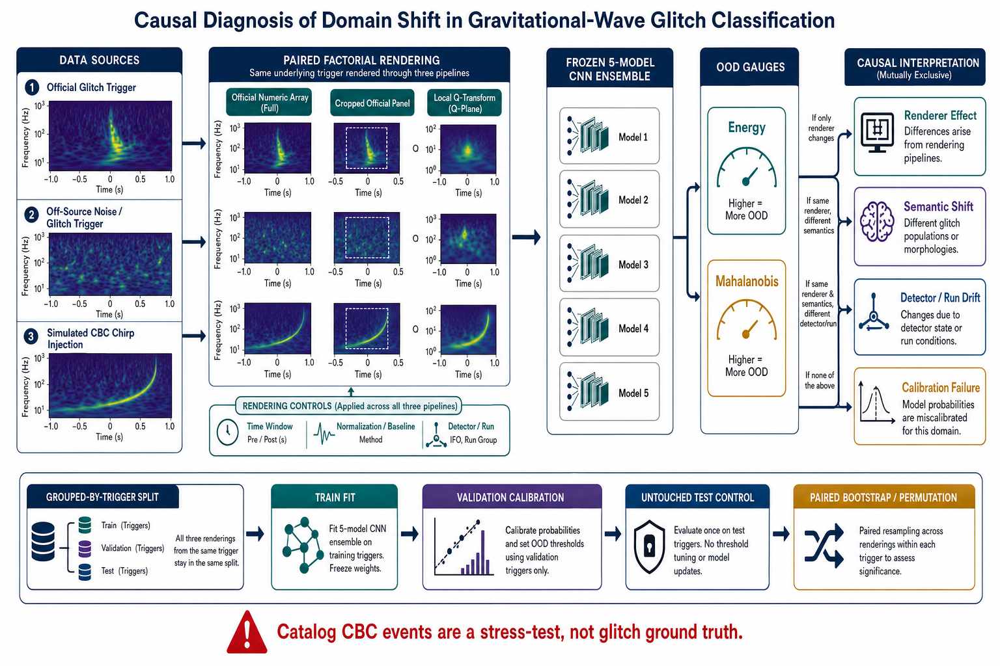

# Parecer científico sênior e roteiro de decisão

Data de consolidação: 27 de julho de 2026.

## Escopo auditado

Este parecer cobre o projeto canônico `gwproject-1.0.1`, os 218 eventos do
catálogo, os 475 canais aprovados, o corpus Gravity Spy harmonizado, os cinco
checkpoints, os diagnósticos ridge e matched filter e o programa de pesquisa.
As ramificações `atenuacao_ridge` e `ridge_atenuacao` foram deliberadamente
excluídas de toda leitura, execução e modificação.

## Veredito

O projeto possui uma base de engenharia e reprodutibilidade suficientemente
forte para sustentar um estudo metodológico. Ainda não sustenta uma classificação
física de glitches nos 218 eventos, uma nova taxonomia, uma medição independente
de massa ou uma busca de detecção.

O núcleo publicável mais promissor não é “aplicar Gravity Spy ao GWTC-4”. É
construir um benchmark causal, pareado por trigger, que meça quanto da decisão de
uma CNN de glitches sobrevive à mudança de representação. O resultado negativo
observado nos 218 eventos é um excelente _stress test_, mas não identifica a
causa da falha porque muda simultaneamente representação, população e finalidade
da amostra.

Em termos editoriais: um periódico exigente rejeitaria uma versão centrada nas
classes forçadas `None_of_the_Above` e `Extremely_Loud`. Consideraria seriamente
uma versão centrada em proveniência de representação, calibração open-world e
controles pareados, desde que os experimentos discriminantes abaixo sejam
executados.

## Evidência efetivamente estabelecida

| Objeto | Resultado em todo o escopo | Força da evidência | Limite |
|---|---:|---|---|
| Catálogo | 218 eventos; 654 combinações evento–detector; 475 canais aprovados; 179 rejeitados | forte | disponibilidade pública desigual entre detectores |
| Gravity Spy limpo | 7.807 imagens; 5.472 treino, 1.177 validação, 1.158 teste; 22 classes em cada split | forte | um único corpus e uma cadeia de renderização |
| CNN, cinco sementes | macro-$F_1=0{,}9449\pm0{,}0092$ no teste oficial | forte para validade interna | não estabelece transferência |
| Calibração OOD v4 | Mahalanobis ajustado no treino, percentis calibrados na validação, controle no teste | forte para consistência in-domain | não garante OOD universal |
| Controle OOD no teste | energy: 4,4–6,0% acima de 0,95 e 0,4–1,4% acima de 0,99; Mahalanobis: 3,4–5,4% e 0,4–1,2% | compatível com os quantis nominais | controle descritivo, não demonstra separação de todos os shifts |
| 475 canais externos | todos acima do percentil 0,99 de Mahalanobis nos cinco modelos | forte para mudança no espaço latente | energy quase nunca rejeita; a causa do shift permanece não identificada |
| Classes fechadas forçadas | 244 `None_of_the_Above`, 230 `Extremely_Loud`, 1 `Repeating_Blips` | apenas diagnóstico computacional | não são rótulos físicos reportáveis |
| Probe de nove estatísticas | balanced accuracy 0,769; AUROC 0,817, com folds agrupados por evento | evidência pós-hoc de dependência de propriedades globais | não localiza o atalho nem separa renderer de semântica |
| Ridge | 201/475 ajustes aceitos; erro relativo mediano 34,7%; 90/201 dentro de 30% | diagnóstico catálogo-condicionado | não é estimador cego validado |
| Matched filter | 164/218 análises completas; sete gates locais; zero gates completos | teste de consistência local | sem background, FAR, $\chi^2$ ou busca cega |

## Correção crítica da calibração OOD

A referência OOD anterior, formato 3, ajustava médias/covariância de Mahalanobis
e calibrava a distribuição empírica usando as mesmas 1.177 amostras de
validação. Esse reuso induzia otimismo in-sample. No split oficial de teste, o
suposto limiar de 99% rejeitava entre 26% e 30% das imagens in-domain, dependendo
do checkpoint. Portanto, aquele artefato não podia sustentar inferência externa.

O formato 4 corrige o desenho:

1. médias por classe e matriz de precisão são ajustadas nas 5.472 amostras de
   treino;
2. energia e distância são convertidas em percentis pelas 1.177 amostras de
   validação;
3. as 1.158 amostras de teste servem apenas como controle final;
4. cada referência permanece vinculada ao checkpoint por SHA-256.

Depois da correção, os falsos alarmes Mahalanobis no teste retornaram aos níveis
nominais, mas todos os 475 canais catalogais continuaram acima do percentil 0,99
nos cinco modelos. Logo, o defeito de calibração existia e inflava o resultado,
mas não explica a separação extrema dos dados externos. A discordância com
energy deve ser reportada, não escondida por uma regra agregadora.

O artefato inválido foi preservado em
`outputs/legacy/research_invalid_ood_v3_20260727/`. Ele é histórico e não deve
ser citado como resultado científico.

## Explicações concorrentes

### E1 — Incompatibilidade de renderer

Os PNGs Gravity Spy e os Q-grams numéricos catalogais passam por cadeias
distintas de geração, intensidade e enquadramento. O probe pós-hoc mostra que
estatísticas globais ajudam a reproduzir as decisões forçadas. Esta explicação é
compatível com os dados, mas ainda não foi isolada porque as amostras subjacentes
também são diferentes.

### E2 — Incompatibilidade semântica

Gravity Spy é uma taxonomia de triggers de ruído instrumental. Os 218 alvos
catalogais são eventos CBC publicados, centrados no tempo do evento. Esperar que
eles ocupem o domínio de classes de glitches é uma hipótese adicional, não uma
verdade de referência. Essa é a principal alternativa a E1.

### E3 — Drift de detector e observing run

As populações de glitches variam entre H1 e L1, e estudos de O3 e O4 tratam
detector/run como domínios relevantes. O drift pode ampliar E1 e E2, mas o
catálogo atual não permite separá-lo do tipo de amostra.

### E4 — Fragilidade específica do score Mahalanobis

Energy não reproduz a rejeição extrema. É possível que distância latente
class-condicional seja particularmente sensível ao shift atual. A conclusão OOD
deve, portanto, ser comparada com kNN no embedding, densidade class-condicional,
conformal e Outlier Exposure.

### E5 — Nova classe de glitch

Não há suporte atual. Todos os canais são de um domínio semanticamente diferente,
e nenhum deles dispõe de rótulo causal de glitch. Além disso, uma análise recente
com mais de 188 mil espectrogramas O4a não encontrou morfologias novas no
conjunto estudado, apesar de controles de estabilidade e ablação. Isso não prova
ausência universal, mas eleva o padrão exigido para alegar novidade.

## Hipóteses discriminantes e previsões

### H-R — O renderer domina a rejeição

**Predição:** o mesmo trigger Gravity Spy muda de status OOD quando apenas o
renderer muda, mantendo strain/array, janela física e split constantes.

**Teste decisivo:** para cada trigger, produzir três versões pareadas: array
numérico oficial, painel oficial recortado e Q-transform local. Nenhuma versão do
mesmo trigger pode atravessar folds.

**Falsificação:** o status e as métricas permanecem estáveis entre renderers,
mas mudam entre glitches e CBCs renderizados de modo idêntico.

### H-S — A semântica glitch versus CBC domina

**Predição:** injeções CBC e eventos centrados no coalescimento permanecem OOD
mesmo quando renderizados pelo pipeline oficial, enquanto glitches off-source
entram no domínio.

**Teste decisivo:** comparar, sob renderer idêntico, triggers Gravity Spy,
glitches off-source, ruído off-source, injeções CBC e os 218 eventos.

**Falsificação:** todos os tipos locais são igualmente rejeitados e a rejeição
desaparece ao trocar apenas o renderer.

### H-I — Estatísticas de intensidade funcionam como atalho

**Predição:** equalização, monotonic transforms e substituição de margens alteram
classes e embeddings mais do que perturbações fisicamente equivalentes.

**Teste decisivo:** intervenções pareadas que preservem ridge/geometria e
modifiquem somente histograma, baseline, colormap ou elementos gráficos.

**Falsificação:** probes permanecem próximos ao acaso e as decisões são
invariantes às intervenções de intensidade.

### H-M — Mahalanobis é mais frágil que outros detectores OOD

**Predição:** a separação externa cai substancialmente com kNN, conformal ou
Outlier Exposure, apesar de controles in-domain equivalentes.

**Teste decisivo:** usar os mesmos splits, embeddings e conjuntos OOD, sem
selecionar o método pelo resultado no teste.

**Falsificação:** a rejeição é reproduzida por famílias metodologicamente
distintas e pelos controles deslocados positivos.

### H-D — Detector/run modifica o efeito

**Predição:** há interação renderer × detector/run, não apenas efeitos marginais.

**Teste decisivo:** holdouts por detector e run, com triggers pareados e
intervalos agrupados.

**Falsificação:** a interação é pequena e compatível com zero dentro da precisão
planejada.

## Desenho experimental recomendado

O estudo deve ser fatorial e bloqueado por trigger. Fazer uma ablação por vez
confundiria interações, justamente o ponto mais provável de falha.

| Bloco/fator | Níveis principais | Papel |
|---|---|---|
| Tipo de amostra | glitch rotulado, glitch off-source, ruído off-source, CBC injetado, CBC catalogal | separa semântica |
| Renderer | array oficial, painel oficial recortado, Q-transform local | estima efeito causal de representação |
| Janela | 0,5 s, 1 s, 2 s, 4 s | testa informação multiescala |
| Intensidade/baseline | oficial, global, por frequência, equalizado | testa atalhos |
| Detector/run | H1/L1 e partições temporais disponíveis | mede drift e interação |
| Método OOD | energy, Mahalanobis, kNN, conformal/OE | mede robustez metodológica |

Regras:

- randomizar a ordem de renderização e inferência;
- bloquear por trigger e manter todas as variantes no mesmo split;
- estimar normalização somente no treino;
- ajustar Mahalanobis no treino, calibrar no conjunto de validação e abrir o
  teste uma única vez;
- usar bootstrap pareado ou permutação por trigger;
- reportar efeitos principais e interações com intervalos, inclusive resultados
  nulos;
- executar piloto apenas para estimar variância, correlação intratrigger e custo;
- definir o tamanho confirmatório por simulação de poder para o menor efeito
  considerado relevante, antes de abrir o holdout final.

## Papel correto dos 218 eventos

Os 218 eventos devem permanecer completos, sem seleção favorável, em quatro
funções:

1. _stress test_ externo de mudança de domínio;
2. controle positivo de estrutura CBC em Q-transform;
3. atlas de disponibilidade/qualidade por detector;
4. conjunto externo para avaliar estabilidade de decisões entre canais da rede.

Eles não fornecem _ground truth_ para classes Gravity Spy. Para validar
transferência de taxonomia é necessário adicionar triggers de glitch rotulados,
off-source e renderizados pelas mesmas cadeias.

## Linhas de pesquisa priorizadas

| Prioridade | Linha | Viabilidade | Potencial | Condição para prosseguir |
|---:|---|---|---|---|
| 1 | Benchmark pareado de proveniência e invariância de renderer | alta | alto | obter arrays oficiais e produzir os três renderers do mesmo trigger |
| 2 | Open-world sinal versus glitch com off-source e injeções | média/alta | alto | ground truth simulado e splits por trigger |
| 3 | Mapa de identificabilidade do ridge | média | moderado | campanha cega de injeção em $(M_\mathrm{det},q,\rho,T)$ |
| 4 | Modelo phase-aware/temporal | média/baixa | alto | comparação justa com DeepExtractor/GlitchGAN e métrica de waveform |
| 5 | Atlas de fragilidade sinal–glitch | baixa no curto prazo | muito alto | infraestrutura BayesWave/`bilby_glitch` e orçamento computacional |

Devem ser despriorizados:

- artigo baseado nas classes forçadas dos 218 eventos;
- clustering de `None_of_the_Above` antes dos controles pareados;
- matched filter local como contribuição autônoma;
- alegações de novidade morfológica sem recorrência, estabilidade, time slides e
  validação instrumental;
- tentativa de transformar o ridge atual em medição de massa apenas ajustando
  thresholds.

## Roteiro de execução

### Fase 0 — concluída

- corrigir contrato dos eixos do Q-gram;
- reprocessar todos os 475 canais;
- corrigir calibração Mahalanobis;
- validar no teste Gravity Spy;
- preservar artefatos inválidos como legado;
- tornar reproduzível o probe sobre os 218 eventos.
- consolidar QC, CNN/OOD, ridge e matched filter em uma tabela um-para-um com
  todos os 218 eventos.

### Fase 1 — dados pareados

- obter os arrays numéricos oficiais Gravity Spy, não apenas PNGs;
- construir um índice imutável de triggers;
- gerar os três renderers por trigger;
- selecionar segmentos off-source e registrar DQ/PSD;
- preparar injeções CBC em ruído real com sementes e parâmetros completos.

### Fase 2 — experimento confirmatório

- congelar folds e análise;
- executar o desenho fatorial ou uma fração de resolução adequada;
- avaliar os cinco checkpoints e baselines simples;
- comparar métodos OOD;
- produzir intervalos pareados e análise de interações.

### Fase 3 — decisão editorial

- se renderer dominar: artigo metodológico de proveniência/shortcut;
- se semântica dominar: artigo de limites de transferência e tarefa
  sinal-versus-glitch;
- se ambos interagirem: artigo de benchmark causal multi-domínio;
- se o efeito desaparecer nos controles: relatar a falha local como correção de
  pipeline, sem vender uma nova descoberta.

## Critérios de avanço e interrupção

Avançar para manuscrito somente se:

- o controle in-domain permanecer calibrado;
- o efeito renderer for estimado com pares do mesmo trigger;
- houver um conjunto OOD positivo com origem conhecida;
- a conclusão for estável entre sementes e pelo menos dois métodos OOD;
- classes físicas forem avaliadas com rótulos adequados.

Interromper ou reformular a linha se:

- a separação desaparecer quando o trigger é mantido fixo;
- o resultado depender de um único score OOD;
- o probe simples explicar a maior parte das decisões após harmonização;
- o custo de obter ground truth impedir um teste causal;
- a contribuição se reduzir a reimplementar GSpyNetTree, GSpyNetTreeS,
  DeepExtractor ou clustering O4a sem diferencial mensurável.

## Posicionamento perante a literatura

A busca dirigida não encontrou, até 27 de julho de 2026, um estudo GW que
execute exatamente o benchmark pareado “mesmo trigger, múltiplos renderers,
splits agrupados e calibração OOD independente”. Isso deve ser descrito como
“não encontrado na busca de escopo dirigida”, nunca como exclusividade.

O diferencial precisa ser formulado contra trabalhos próximos:

- [Gravity Spy O3](https://arxiv.org/abs/2208.12849): distribuição e
  caracterização por detector;
- [multi-view para O4](https://arxiv.org/abs/2401.12913): informação de múltiplas
  janelas e generalização de arquitetura;
- [GSpyNetTree](https://arxiv.org/abs/2304.09977): classificação
  sinal-versus-glitch sob cenários de fundo, glitches novos e sobreposição;
- [GSpyNetTreeS](https://arxiv.org/abs/2511.16861): localização
  tempo–frequência de glitches para vetting;
- [CTSAE](https://arxiv.org/abs/2404.15552): clustering multitemporal;
- [DINOv2 em O4a](https://arxiv.org/abs/2605.28572): clustering, estabilidade,
  ablações e resultado nulo para novas morfologias;
- [DeepExtractor](https://arxiv.org/abs/2501.18423) e
  [GlitchGAN](https://arxiv.org/abs/2606.27227): reconstrução e geração no domínio
  temporal;
- [`bilby_glitch`](https://arxiv.org/abs/2607.09111): inferência conjunta
  sinal–glitch.

## Conclusão

A CNN está validada para o benchmark interno que recebeu. Ela falha como
classificador externo dos Q-grams catalogais atuais, e o projeto agora mede essa
falha de modo tecnicamente defensável. O próximo ganho científico não virá de
mais uma arquitetura nem de mais thresholds. Virá de um desenho em que o mesmo
objeto físico atravessa renderers controlados, permitindo atribuir causalmente a
falha à representação, à semântica ou ao detector.
