# Programa científico: representações, glitches e robustez inferencial

_Formulação prospectiva para experimentos de validade externa em dados de ondas gravitacionais._

---

## 🎯 Problema científico

Classificadores de glitches são treinados sobre representações tempo–frequência específicas. O desempenho interno não estabelece que as fronteiras aprendidas sejam invariantes a renderer, normalização, janela temporal, detector ou run observacional.

A pergunta central é:

> Quais características aprendidas por classificadores de transientes são invariantes à representação e fisicamente informativas, e quais correspondem a atalhos do pipeline de visualização ou do conjunto de treinamento?

A investigação separa quatro objetos que não devem ser confundidos:

| Objeto | Definição operacional | Evidência necessária |
| --- | --- | --- |
| Morfologia observada | Aparência em uma representação escolhida | Estabilidade dentro do renderer |
| Forma de onda | Estrutura temporal, espectral e de fase | Reconstrução ou análise no domínio temporal |
| Causa instrumental | Mecanismo físico do detector | Canais auxiliares, estado instrumental e validação especializada |
| Efeito inferencial | Viés sobre parâmetros astrofísicos | Injeções e recuperação com modelos alternativos |

## 🧭 Escopo e exclusões

O programa estuda validade externa, incerteza e sensibilidade à representação. Ele não transforma uma classificação visual em diagnóstico causal do detector.

São permitidas alegações sobre:

- desempenho interno e em holdouts definidos previamente
- mudança de domínio entre renderers
- estabilidade entre sementes
- calibração, incerteza e rejeição OOD
- sensibilidade a intervenções sobre intensidade, geometria e fase

Não são permitidas alegações sobre:

- detecção de eventos sem background e false-alarm rate
- identificação causal de glitch sem canais auxiliares
- veto detectorial baseado apenas na CNN
- superioridade astrofísica sem campanha de injeção e recuperação

## 🧪 Hipóteses falsificáveis

### H1 — As fronteiras de classe dependem da representação

**Predição:** parte das decisões muda sob transformações que preservam a informação física relevante, como alteração de renderer, remoção de elementos gráficos e equalização de intensidade.

**Falsificação:** desempenho e calibração permanecem estáveis em renderer holdout, detector holdout e run holdout.

### H2 — Estatísticas de baixo nível funcionam como atalhos

**Predição:** probes simples baseados em percentis, média e dispersão reproduzem parte substancial das decisões do classificador.

**Falsificação:** probes agrupados permanecem próximos ao acaso e intervenções sobre intensidade não alteram as predições.

### H3 — A fase contém informação necessária para identificabilidade

**Predição:** contrafactuais que preservam magnitude espectral e alteram fase degradam tarefas temporalmente informadas, mesmo quando classificadores visuais mantêm alta confiança.

**Falsificação:** modelos sensíveis à fase não melhoram generalização ou consistência física.

### H4 — OOD deve ser calibrado por checkpoint

**Predição:** escalas brutas de energia e coordenadas latentes variam entre sementes, mas percentis empíricos calibrados por modelo podem ser agregados de forma comparável.

**Falsificação:** referências compartilhadas e referências individuais produzem resultados indistinguíveis em testes controlados, incluindo checkpoints treinados independentemente.

### H5 — Coerência de rede acrescenta informação

**Predição:** modelos que incorporam detector, tempo e coerência entre canais distinguem melhor fenômenos locais de estruturas compatíveis entre detectores.

**Falsificação:** essas variáveis não melhoram generalização fora do domínio nem reduzem ambiguidades.

## 🔄 Fluxo experimental

```mermaid
flowchart LR
    accTitle: Open-world validation pipeline
    accDescr: Experimental flow from frozen data and grouped splits through representation controls, multiseed training, model-specific calibration, external evaluation, and constrained scientific claims

    freeze_data([📦 Congelar dados e hashes]) --> grouped_split[📋 Definir splits agrupados]
    grouped_split --> renderers[⚙️ Construir renderers controlados]
    renderers --> train_models[🧠 Treinar múltiplas sementes]
    train_models --> internal_eval[🧪 Avaliar domínio interno]
    internal_eval --> calibrate_ood[📊 Calibrar OOD por checkpoint]
    calibrate_ood --> external_eval[🔍 Testar holdouts e contrafactuais]
    external_eval --> decision{🛡️ Critérios atendidos?}
    decision -->|Sim| bounded_claims[✅ Emitir alegações delimitadas]
    decision -->|Não| revise_design[🔧 Revisar hipótese ou desenho]
    revise_design --> renderers

    classDef process fill:#dbeafe,stroke:#2563eb,stroke-width:2px,color:#1e3a5f
    classDef decision_style fill:#fef9c3,stroke:#ca8a04,stroke-width:2px,color:#713f12
    classDef success fill:#dcfce7,stroke:#16a34a,stroke-width:2px,color:#14532d
    classDef revision fill:#fee2e2,stroke:#dc2626,stroke-width:2px,color:#7f1d1d

    class freeze_data,grouped_split,renderers,train_models,internal_eval,calibrate_ood,external_eval process
    class decision decision_style
    class bounded_claims success
    class revise_design revision
```

## 📊 Matriz experimental mínima

| Fator | Níveis mínimos | Controle obrigatório |
| --- | --- | --- |
| Renderer | oficial, numérico harmonizado, variante alternativa | Mesma amostra e mesmo split |
| Intensidade | original, equalizada, perturbada | Informação geométrica preservada |
| Fase | original, interpolada, randomizada | Magnitude espectral monitorada |
| Detector | H1, L1, V1 quando disponível | Holdout por detector |
| Run | partições observacionais disponíveis | Holdout por run |
| Semente | pelo menos cinco | Mesma configuração e dados |
| OOD | in-domain, renderer deslocado, contrafactual | Threshold fixado na validação |

A unidade de independência deve ser evento ou trigger, não imagem isolada. Variantes da mesma observação permanecem no mesmo fold.

## 🔬 Calibração open-world

Cada checkpoint possui:

- média por classe ajustada no split de treino do próprio espaço latente
- matriz de precisão estimada no split de treino do próprio espaço latente
- distribuição de calibração do energy score no split de validação
- distribuição de calibração da distância mínima de Mahalanobis no split de validação
- controle independente no split oficial de teste
- hash SHA-256 que vincula checkpoint e referência

Na inferência, cada modelo produz escores brutos em sua própria escala. Esses
escores são convertidos em percentis empíricos usando apenas a distribuição de
validação correspondente. O teste não pode ser usado para reajustar threshold,
covariância ou preprocessing. A decisão do ensemble depende da fração de modelos
acima dos quantis preregistrados.

Este procedimento impede duas operações inválidas:

1. aplicar uma covariância estimada em um espaço latente a embeddings de outra rede
2. comparar a média de energias de um ensemble com um limiar obtido de um único modelo
3. ajustar a geometria Mahalanobis e calibrar seus percentis nas mesmas amostras

Energy e Mahalanobis são diagnósticos distintos. Discordância entre eles deve
ser reportada explicitamente e impede apresentar `reject_ood` como consenso
metodológico universal.

## 📐 Plano estatístico

As análises confirmatórias devem incluir:

- intervalos bootstrap agrupados por evento ou trigger
- comparação pareada entre renderers da mesma amostra
- teste de permutação com estrutura de grupos preservada
- correção de Benjamini–Hochberg para famílias secundárias
- tamanho de efeito e intervalo de confiança, não apenas valor de p
- separação explícita entre validação, seleção de threshold e teste final

As métricas primárias são:

| Questão | Métrica primária |
| --- | --- |
| Desempenho interno | Macro-F1 |
| Validade externa | Macro-F1 em renderer holdout |
| Calibração | ECE e Brier score |
| Reconhecimento OOD | AUROC e FPR@95TPR |
| Atalho de representação | Balanced accuracy do probe agrupado |
| Estabilidade epistemológica | Informação mútua e vote fraction |

## 🛡️ Política de alegações

Uma saída `in_domain_candidate` significa apenas que a amostra não foi rejeitada pelos critérios estatísticos definidos. Não implica que a classe prevista seja fisicamente correta.

Uma saída `reject_ood` significa incompatibilidade segundo a regra agregadora e
o domínio de referência definidos. Não implica sinal astrofísico, novidade
física, glitch ou falha instrumental específica. Quando detectores OOD
discordarem, a tabela por método tem precedência sobre o rótulo agregado.

Resultados de ridge e matched filtering local são diagnósticos condicionados. Sem background, trials factor e validação por injeções, não devem ser descritos como detecção.

## 🚦 Critérios de decisão

O programa avança para interpretação física somente quando:

- o desempenho em renderer holdout é compatível com o desempenho interno dentro da incerteza preregistrada
- a calibração permanece aceitável fora do renderer de treinamento
- probes de baixo nível não explicam sozinhos as decisões
- a rejeição OOD é validada em conjuntos deslocados independentes
- as conclusões são estáveis entre sementes, detectores e runs

A falha em qualquer critério não deve ser ocultada por seleção posterior de subclasses, seeds ou thresholds.

## 📦 Artefatos obrigatórios

Cada resultado publicável deve ser reconstruível a partir de:

- manifestos de ambiente e hardware
- hashes dos dados, configurações e checkpoints
- tabelas por amostra antes de qualquer agregação
- logits e probabilidades, não apenas `argmax`
- referência OOD por checkpoint
- definição dos grupos e splits
- logs de execução
- scripts que regeneram tabelas e figuras

O diretório `outputs/` permanece fora do controle de versão. Resultados destinados a auditoria devem ser depositados em repositório persistente com checksum e identificador estável.
