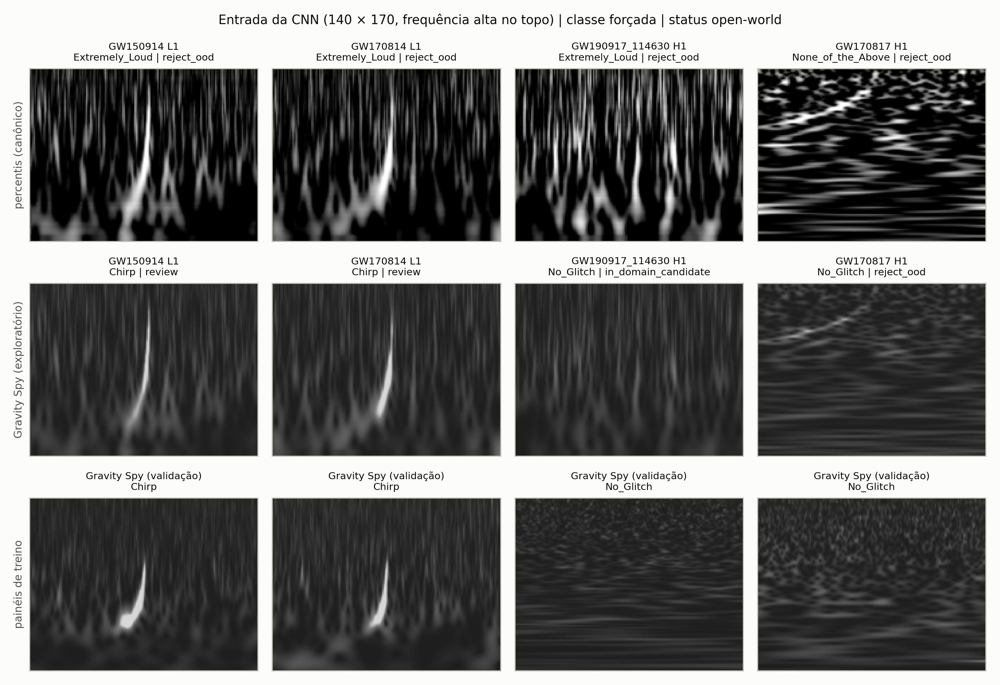
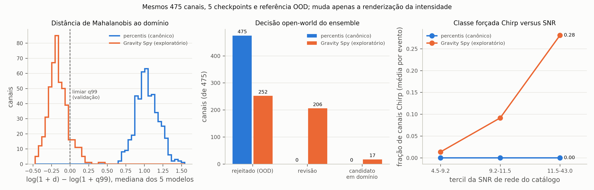
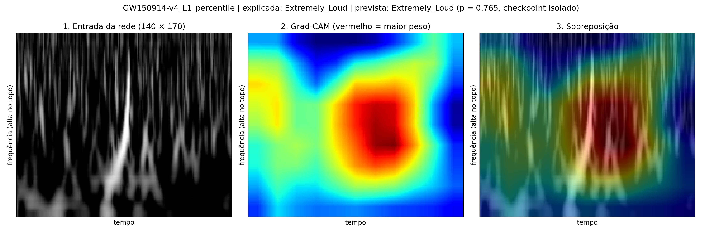
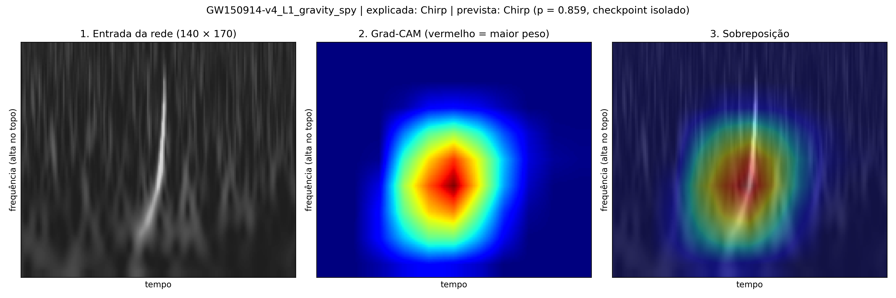

# Renderizador Gravity Spy: incorporação e teste exploratório

Data: 10 de outubro de 2026. Status: **exploratório, não preregistrado**. O
fluxo confirmatório da seção 7 do `PREREGISTRO.md` não muda.

## Origem e pergunta

O repositório [jean5429/gw-pic-2026](https://github.com/jean5429/gw-pic-2026)
(commit `1447593`, licença MIT) propôs renderizar os Q-grams do catálogo na
escala de intensidade dos PNGs Gravity Spy, em vez do estiramento por percentis.
A energia normalizada pela mediana (`q_transform(norm="median")`) é recortada em
`[0, 25,5]`, mapeada em viridis e convertida para cinza, como os PNGs de treino
são convertidos por `convert("L")`. A opção entrou na 1.0.1 como
`render_mode = "gravity_spy"` em `qgram_to_uint8`. O padrão continua
`"percentile"`.

O experimento pareado de intensidade de 18/09/2026 aplicou gama e contraste
**depois** da renderização canônica. A rejeição dos 475 canais não mudou em
nenhuma condição. Aqui a pergunta é outra: o que acontece quando a imagem é
gerada a partir da energia na escala do treino? A intervenção corresponde ao
fator "intensidade/baseline" da matriz do parecer (explicações E1 e H-I).

## Desenho

- Mesmos 475 canais aprovados de 218 eventos, mesmos 5 checkpoints
  `gravity_spy_harmonized_v1d1`, mesma referência OOD formato 4 e mesmos limiares.
  Só muda `render_mode`.
- As duas condições foram executadas em CPU no mesmo ambiente. Detectores
  agregados por evento antes do bootstrap pareado (2.000 réplicas, semente
  20261010, blocos = eventos).
- Controle de ambiente: a condição `percentile` em CPU foi comparada com a
  execução canônica de julho em GPU.
- Nenhum limiar, checkpoint ou referência foi ajustado. O renderer foi
  implementado antes de qualquer inferência e não foi escolhido entre variantes.

Comandos e artefatos: `outputs/research/renderer_gravity_spy_20261010/`
(não versionado; `README.md` e `ARTIFACT_HASHES.sha256` na pasta).

## Resultados

### Controle de ambiente

CPU (fp32, torch 2.14) e GPU canônica (autocast, torch 2.5.1) produziram as
mesmas decisões OOD e a mesma classe forçada nos 475 canais. A maior diferença
de confiança foi 0,001. As diferenças abaixo não vêm do ambiente.

### Nível de cinza da entrada

Mediana por imagem do cinza apresentado à CNN (140 × 170), mediana entre imagens:

| Conjunto | Mediana do cinza (IQR) | p99 do cinza |
|---|---:|---:|
| Gravity Spy, validação (1.177 painéis) | 40 (39–41) | 100 |
| Catálogo, renderer `gravity_spy` | 42 (42–43) | 89 |
| Catálogo, renderer `percentile` | 15 (12–19) | 223 |

A escala 0–25,5 reproduz o fundo e a cauda dos painéis de treino. O renderer
canônico leva o fundo para perto do preto e a cauda para perto da saturação.

### Decisão open-world

Médias por evento (218 blocos), com intervalo exploratório de 95%:

| Métrica | `percentile` | `gravity_spy` | Diferença [IC 95%] | Canais |
|---|---:|---:|---|---|
| `reject_ood` | 1,000 | 0,544 | −0,456 [−0,505; −0,406] | 475 → 252 |
| `review` | 0,000 | 0,420 | +0,420 [+0,374; +0,467] | 0 → 206 |
| `in_domain_candidate` | 0,000 | 0,036 | +0,036 [+0,018; +0,056] | 0 → 17 |
| Mahalanobis acima de q99 | 1,000 | 0,115 | −0,885 [−0,917; −0,853] | 475 → 49 |
| Energy acima de q99 | 0,000 | 0,489 | +0,489 [+0,440; +0,539] | 0 → 227 |
| Excesso de Mahalanobis (log) | +1,039 | −0,153 | −1,192 [−1,213; −1,171] | — |
| Confiança fechada do ensemble | 0,735 | 0,536 | −0,200 [−0,225; −0,174] | — |
| Classe forçada alterada | — | 0,973 | — | 464 de 475 |

O excesso de Mahalanobis é `log(1 + d) − log(1 + q99)`, mediana dos cinco
modelos; valores negativos ficam abaixo do limiar de 99% da validação.

Os dois escores andam em sentidos opostos. A distância de Mahalanobis cai para
perto do limiar: a mediana dos canais fica abaixo de q99. O energy, que quase
nunca rejeitava, passa a rejeitar 227 canais, porque a rede fica menos confiante.
A rejeição agregada cai porque a regra exige um dos dois escores acima de q99.
No nível de evento, 172 eventos ainda têm ao menos um canal `reject_ood`, 44 têm
no máximo `review` e 2 têm todos os canais como `in_domain_candidate`. A
discordância entre escores continua aberta (explicação E4 e hipótese H-M do
parecer).

### Classes forçadas e SNR (pós-hoc)

Com `percentile`, as classes forçadas são `None_of_the_Above` (244) e
`Extremely_Loud` (230), sem relação com a SNR de rede publicada. Por evento,
Spearman entre SNR e excesso de Mahalanobis = −0,12; as frações de classe são
constantes. Com `gravity_spy`, aparecem `No_Glitch` (267), `Chirp` (58) e
`Blip` (54), e a associação com a SNR fica forte:

| Tercil de SNR de rede | Fração `Chirp` | Fração `No_Glitch` | Fração `reject_ood` |
|---|---:|---:|---:|
| 4,5–9,2 | 0,014 | 0,730 | 0,417 |
| 9,2–11,5 | 0,092 | 0,587 | 0,575 |
| 11,5–43,0 | 0,281 | 0,317 | 0,644 |

Por evento, Spearman(SNR, fração `Chirp`) = +0,50 e Spearman(SNR, fração
`No_Glitch`) = −0,50. GW150914 (H1 e L1), GW230814 e GW231226 são forçados para
`Chirp`. Os 17 candidatos em domínio são todos `No_Glitch`, com SNR de rede
entre 7,6 e 14,5, e 4 deles são canais do Virgo. Dos 49 canais ainda acima de
q99 em Mahalanobis, 27 são `Chirp`. Isso é compatível com uma separação
semântica residual: os CBCs mais fortes não ficam próximos dos glitches de treino.

O Grad-CAM do checkpoint de semente 42 para GW150914 L1 concentra o peso da
decisão `Chirp` sobre a trilha do chirp. No renderer canônico, a decisão
`Extremely_Loud` também pesa a textura de ruído amplificada ao redor. É uma
ilustração qualitativa de um canal, não evidência.

## Interpretação permitida

- A rejeição Mahalanobis dos 475 canais é fortemente sensível à renderização da
  intensidade. Boa parte da separação extrema relatada em 27/07/2026 é compatível
  com a incompatibilidade de renderer (E1/H-I).
- Com a intensidade harmonizada, a rejeição remanescente se concentra em canais
  de SNR maior e em chirps fortes. Isso é compatível com mudança semântica (H-S).
  As duas explicações coexistem; os dados não separam suas contribuições.
- A conclusão "todos os 475 canais fora do domínio" é condicionada ao renderer e
  ao escore OOD. Deve ser relatada com esta análise de sensibilidade.

## Não permitido

- "O renderer Gravity Spy resolve a mudança de domínio": 252 canais continuam
  rejeitados e o energy passa a discordar.
- "17 canais não contêm glitch" ou "a CNN identificou os chirps": classes forçadas
  e candidatos em domínio medem similaridade com a taxonomia, não origem física.
- Trocar o renderer canônico com base neste resultado. Ele foi observado sem
  protocolo prospectivo e não é confirmação.

## Limites

1. **Banda de frequência.** Os painéis de treino cobrem a faixa do PNG oficial
   (sem recorte, `apply_frequency_crop = false`). Os Q-grams do catálogo cobrem
   20–512 Hz. O renderer harmoniza só a intensidade. No repositório de origem, os
   painéis eram recortados para 20–512 Hz e os 150 canais do GWTC-3 continuavam
   acima de q99 em Mahalanobis. Lá, porém, os checkpoints eram outros e a
   referência OOD estava no formato anterior ao 4, calibrado na própria validação
   e invalidado aqui em 27/07/2026; os números não são comparáveis.
2. **Escala 0–25,5.** Vem da barra de cor dos PNGs Gravity Spy. O nível de cinza
   coincide com o dos painéis, mas a escala ainda não foi validada com pares
   numéricos do mesmo trigger.
3. **Análise pós-hoc.** Uma variante, um ensemble, um catálogo. Intervalos
   pontuais, sem correção por multiplicidade. A SNR é a de rede publicada no
   catálogo, não a de cada detector.
4. **Energy versus Mahalanobis.** A queda da confiança pode refletir imagens sem
   transiente forte, comuns em eventos de SNR baixa. Isso não foi isolado.

## Próximos passos sugeridos

1. Incluir os dois renderers como níveis do fator "renderer/intensidade" no
   benchmark pareado da Fase 1. São triggers Gravity Spy rotulados, com Q-transform
   local a partir do strain público e mesmo split. Só assim o efeito do renderer é
   medido onde a classe verdadeira é conhecida.
2. Harmonizar também a banda: recortar os painéis em 20–512 Hz e retreinar, ou
   calcular os Q-grams do catálogo na banda do PNG. Registrar a escolha antes de
   ver o resultado.
3. Comparar energy e Mahalanobis com kNN no embedding e métodos conformais (H-M),
   nos mesmos splits.
4. Manter `render_mode = "percentile"` como canônico até um protocolo
   prospectivo decidir o contrário.
