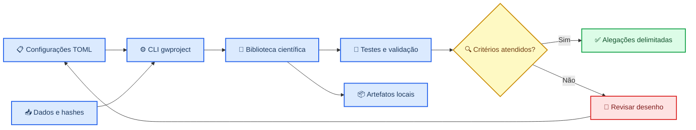

# Relatório de validação da versão pura

_Reconstrução estrutural e científica do GWProject — 26 de julho de 2026._

---

## Errata (26 de julho de 2026, pós-publicação)

Esta reconstrução **não corrigiu** o bug de eixo do Q-gram catalogal identificado na
auditoria de 25/07/2026 (`bug_eixo_qgram`, memória de projeto) — apesar de a seção
"Correções científicas centrais" abaixo poder sugerir o contrário. A seção
"Pré-processamento Gravity Spy" descreve corretamente uma correção real, mas trata do
recorte do **painel PNG de treino** (`panel_preprocessing.py`); o bug de eixo vivia em
`qgram_inference.py` (inferência sobre Q-grams catalogais reais, ex. GW150914) e não é
mencionado neste relatório nem em `PREREGISTRO.md` como originalmente publicado.

A correção foi implementada e validada empiricamente contra o artefato real de GW150914
(recuperação da assinatura de chirp esperada, ridge de frequência sobe de ~38 Hz para
~260 Hz em torno do GPS do evento) nesta mesma data. Detalhes completos, evidência e testes
atualizados: `research/PREREGISTRO.md` seção 16. Nenhum número catalogal (classificação,
OOD, ensemble) gerado com uma cópia do pacote anterior a esta errata é válido.

---

## 🎯 Objetivo da reconstrução

A versão pura elimina identidades históricas concorrentes, wrappers versionados, relatórios derivados sem artefatos de origem e mecanismos implícitos de compatibilidade. O projeto passa a ter um único pacote, uma única interface de linha de comando e uma configuração científica prospectiva.

O trabalho não consistiu apenas em renomear arquivos. Foram corrigidos dois problemas capazes de invalidar resultados: a mistura de espaços latentes entre checkpoints na análise OOD e o pré-processamento heurístico adotado como se fosse a representação oficial do Gravity Spy.

## 🧭 Arquitetura resultante

## 🔧 Alterações estruturais

| Área | Estado anterior | Estado atual |
| --- | --- | --- |
| Identidade | nomes e wrappers associados a gerações distintas | pacote único `gwproject`, versão `1.0.0` |
| Interface | scripts independentes e automação duplicada | CLI `gwproject` e namespace `gwproject research` |
| Código executável | scripts externos ao pacote | comandos em `src/gwproject/commands/` |
| Documentação | relatórios históricos misturados ao código | programa prospectivo, preregistro e política de alegações |
| Resultados | resumos sem entradas suficientes para reprodução | `outputs/` vazio por padrão; resultados devem ser regenerados |
| Automação | caminhos e nomes versionados | `tools/run_catalog.ps1` e `tools/run_research_program.ps1` |
| GPU | wheels fixadas por URL e ABI do Python | índice oficial PyTorch e versões configuráveis[^3] |

A varredura final não encontrou referências aos wrappers removidos, documentos de migração, nomes históricos do pacote ou marcadores de atualização entre gerações.

## 🔬 Correções científicas centrais

### Calibração OOD por checkpoint

A referência OOD agora é construída individualmente para cada checkpoint. Cada bloco contém:

- médias por classe no espaço latente do próprio modelo
- matriz de precisão estimada nesse mesmo espaço
- distribuição empírica de energia na validação
- distribuição empírica da distância mínima de Mahalanobis
- hash SHA-256 do checkpoint correspondente

Na inferência, cada escore bruto é convertido em percentil com a distribuição de validação do mesmo modelo. O ensemble agrega frações de modelos acima dos quantis preregistrados. Isso impede a aplicação de uma covariância de uma rede aos embeddings de outra e evita comparar energia média do ensemble com threshold de um único checkpoint.

### Pré-processamento Gravity Spy

O fluxo confirmatório passa a usar o recorte documentado do conjunto Gravity Spy: linhas `66:532` e colunas `105:671`, seguido de resize para `140×170`. O repositório oficial também disponibiliza arrays HDF5 com dimensão `1×140×170`, que devem funcionar como referência primária de domínio.[^1]

A detecção automática da região escura permanece disponível somente como variante exploratória. O recorte físico `20–512 Hz` também é opt-in, pois depende de uma correspondência pixel–frequência confirmada para o renderer de origem.

### Calibração do classificador

O treinamento agora preserva logits e probabilidades no teste, ajusta temperature scaling exclusivamente na validação e produz:

- ECE bruto e calibrado
- Brier score bruto e calibrado
- NLL bruta e calibrada
- diagrama de confiabilidade
- arquivo `test_predictions.npz`
- estados de otimizador, scheduler e scaler no checkpoint

O modo determinístico desativa TF32 para evitar uma promessa de reprodutibilidade incompatível com a configuração numérica.

### Proveniência operacional

A referência OOD verifica checkpoints por SHA-256. Os relatórios de execução registram configuração e manifestos. O preregistro fixa o fluxo confirmatório e classifica mudanças de renderer como experimentos separados, não como substituições silenciosas.

## 🤗 Uso das skills solicitadas

O catálogo Hugging Science foi consultado para astronomia, física e raciocínio científico. Nenhum dataset ou modelo externo foi incorporado: os recursos encontrados não eram suficientemente alinhados à modalidade de Q-transforms, à taxonomia Gravity Spy e ao problema específico de validade externa/OOD. Adicionar um foundation model apenas por disponibilidade aumentaria a complexidade sem resolver a identificação causal ou a mudança de renderer.[^2]

A skill `deepTools` foi deliberadamente excluída da implementação. Ela opera sobre dados NGS, especialmente BAM, bigWig e BED; o projeto trabalha com strain, espectrogramas e catálogos de ondas gravitacionais. Utilizá-la seria uma incompatibilidade de domínio, não uma ampliação metodológica.

## ✅ Validação executada

| Verificação | Resultado |
| --- | ---: |
| Compilação de `src/` | aprovada |
| Testes automatizados | **58 aprovados** |
| Falhas de teste | **0** |
| Cobertura do núcleo científico | **66%** |
| Instalação editável sem dependências | aprovada |
| `gwproject --help` | aprovado |
| `gwproject research --help` | aprovado |
| Ajuda dos comandos OOD e painéis | aprovada |
| Varredura de resíduos históricos | nenhuma ocorrência relevante |

A cobertura exclui intencionalmente comandos de orquestração e mede o núcleo importável. Os módulos com menor cobertura continuam sendo os que dependem de rede, arquivos reais ou execução integrada: `gwosc_pipeline.py`, `downloads.py`, `gravity_spy.py`, `catalog_analysis.py` e `qgram_inference.py`.

## ⚠️ Limites que permanecem

Esta reconstrução foi validada estruturalmente e por testes automatizados, mas não executou:

- aquisição completa e atual do GWOSC
- treinamento GPU sobre o conjunto integral Gravity Spy
- campanha multiseed completa
- classificação catalogal com checkpoints reais
- benchmark OOD com conjuntos externos independentes
- campanhas de injeção e recuperação
- validação do ridge contra inferência estabelecida
- background por time slides para matched filtering

Por isso, o pacote está em condição superior para pesquisa reprodutível, mas seus resultados futuros ainda dependerão dessas validações. Nenhuma contagem, classe catalogal ou alegação física antiga foi transportada como resultado válido.

Também permanecem duas decisões institucionais não técnicas: definição explícita de licença e autoria para distribuição pública. Elas não foram inventadas durante a limpeza.

## 📋 Critério de aceite

A versão deve ser considerada a base canônica somente quando:

1. os dados usados em cada experimento estiverem congelados e identificados por hash
2. o pipeline integral for executado em ambiente reconstruído do zero
3. logits, probabilidades e tabelas por amostra forem preservados
4. OOD for avaliado em deslocamentos independentes
5. resultados forem comparados com bibliotecas e procedimentos estabelecidos da área
6. licença e política de redistribuição dos artefatos forem formalizadas

---

[^1]: Gravity Spy Project. “Gravity Spy Training Set.” Zenodo. https://zenodo.org/records/1486046

[^2]: Hugging Science. “Curated scientific datasets, models, blogs, and Spaces.” https://huggingscience.co/llms-full.txt

[^3]: PyTorch. “Previous PyTorch Versions.” https://pytorch.org/get-started/previous-versions/
